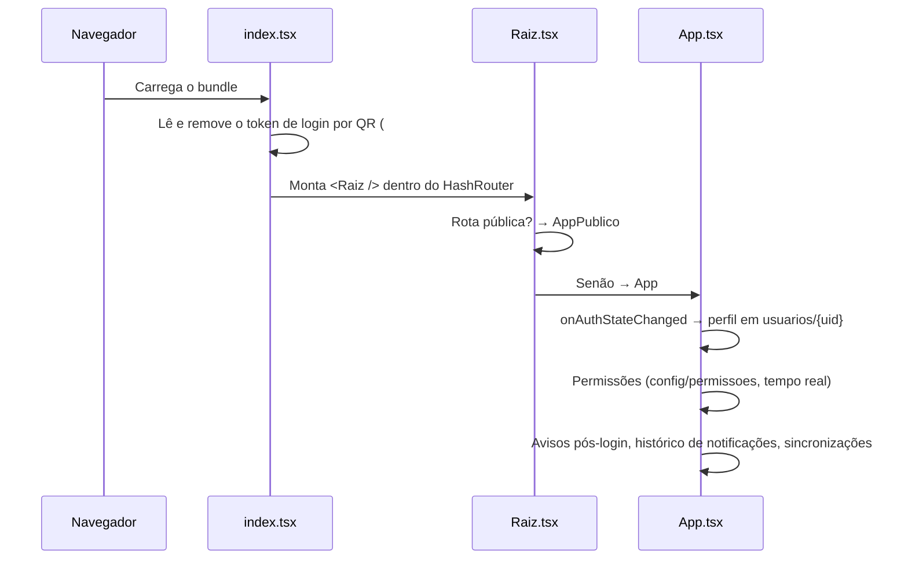
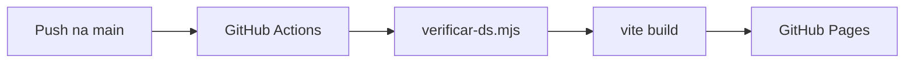
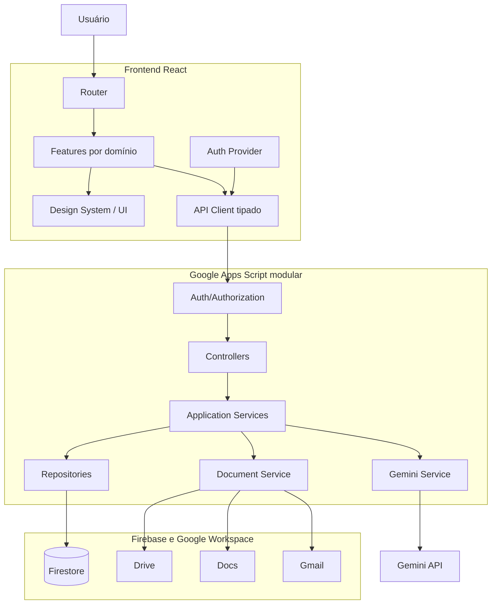

# Arquitetura do Sistema

## 1. Visão geral

> **Atualizado em 31/10/2026.**

O **Guia Médico Naval — JRS/HNRe** é uma aplicação web de página única (*Single Page Application* — SPA), instalável como PWA, voltada ao apoio das atividades médico-periciais da Junta Regular de Saúde do Hospital Naval de Recife.

A solução combina cinco grupos principais de capacidades:

1. **Consulta de conteúdo normativo e médico-pericial**, armazenado majoritariamente no próprio código-fonte (com páginas públicas, sem login, para as Doenças de Lei e a Portaria).
2. **Trabalho da JRS**: Inspeções de Saúde e agenda dos peritos, concursos (planilha de candidatos, triagem, exames, termos), pareceres, perícias menores e inspecionados, com dados no **Cloud Firestore**.
3. **Automação documental**, executada por Google Apps Script (`CodeConcursos.gs`) com Google Docs, Drive, Gmail e Google Agenda — inclusive o envio automático de documentos por e-mail para impressão.
4. **IA (Gemini)**: leitura de atestados (Apps Script), transcrição de mensagens e de exames de candidatos (Apps Script e servidor no Cloud Run).
5. **Notificações push** (Firebase Cloud Messaging), com histórico por usuário no app.

O frontend é publicado como site estático no GitHub Pages. O backend tem duas partes: um **servidor Node/Express no Cloud Run** (`server.ts`, com o Firebase Admin SDK) para o que exige credencial de servidor — operações de Admin, notificações, Gemini — e o **Apps Script** para a automação do Google Workspace. Os dados operacionais ficam no Firestore e no Storage, acessados direto pelo navegador e protegidos pelas regras versionadas em `firestore.rules` e `storage.rules`.

> **PWA:** o app tem manifesto (`public/manifest.webmanifest`, nome **JRS/HNRe App**), ícones e um *service worker* (`public/firebase-messaging-sw.js`) usado para o push. Não há cache offline.

---

## 2. Diagrama de contexto


---

## 3. Estilo arquitetural

### 3.1 Frontend

O frontend segue uma arquitetura de SPA baseada em componentes React, com roteamento por URL (`HashRouter`). `components/Raiz.tsx` decide entre o app autenticado (`App.tsx`) e as páginas públicas (`components/publico/`).

Características observadas:

- React 19 com TypeScript;
- Vite como ferramenta de desenvolvimento e *build*;
- componentes funcionais e Hooks;
- estado local com `useState`/`useEffect` e um `NavContext` com usuário, perfil, avisos e notificações;
- leitura em tempo real do Firestore (`onSnapshot`) nas telas de trabalho;
- roteamento por URL com `react-router-dom` (tabela e aliases em `config/routes.ts`; `NavItem` segue como identificador das permissões e a `currentView` é derivada da URL);
- estilos utilitários Tailwind compilados no build (PostCSS) com tokens do design system — classes fora do DS falham o build (`scripts/verificar-ds.mjs`);
- ícones Material Symbols autohospedados (`styles/fonts.css`, `assets/fonts/`; shim `components/ui/icons.tsx`);
- páginas carregadas sob demanda (`React.lazy` + `Suspense` em `App.tsx`): cada tela vira um *chunk* próprio;
- tela de erro (`components/ErroFatal.tsx`) no lugar de tela branca quando uma tela falha;
- conteúdo médico e normativo embutido em componentes e em `constants.ts`;
- dados auxiliares estáticos em `public/*.json`.

### 3.2 Backend

O backend tem duas partes, publicadas separadamente:

**Servidor no Cloud Run (`server.ts`, Node + Express, Firebase Admin SDK).** Todas as rotas exigem o *ID token* do Firebase no cabeçalho `Authorization` (salvo as de login), e as de Admin conferem o perfil no Firestore:

| Rota | Função |
|---|---|
| `POST /api/auth/handoff-token` | Token de login do desktop para o celular (QR code de "Instalar app") |
| `POST /api/auth/resolver-nip` | Login por NIP (devolve só o login e se a senha é temporária; limitado por IP) |
| `POST /api/admin/resetar-senha` | Admin volta a senha de um usuário à inicial |
| `POST /api/admin/excluir-usuario` | Admin apaga um usuário **inativo** (Auth + `usuarios` + `usuarios_publicos`) |
| `POST /api/admin/preview-apresentacao` | Título e capa de uma apresentação (Google Slides, Canva, GitHub Pages) |
| `POST /api/notificacoes/evento` | Recebe um evento (login, status Inapto/IDM, IS finalizada, teste), confere no Firestore, grava o histórico e envia o push |
| `POST /api/gemini/analyze-image` | Leitura de imagem pelo Gemini (exige usuário ativo) |
| `POST /api/concursos/ocr-pdf` | Transcrição literal do PDF de mensagem administrativa (exige usuário ativo) |

O mesmo servidor serve o build em desenvolvimento (`npm run dev`) e libera CORS para a origem do GitHub Pages (`ALLOWED_ORIGIN`).

**Google Apps Script.** `apps-script/concursos/CodeConcursos.gs` concentra a automação do Workspace: geração de PDFs por template (termos, pedidos de parecer, solicitações de exames), gravação no Drive, transcrição de exames e mensagens pelo Gemini, envio de e-mails para impressão e sincronização com o Google Agenda "JRS/HNRe". As ações que gravam exigem o `idToken` do Firebase. `CodePrincipal.gs`, no mesmo projeto, atende a leitura do atestado e a minuta de mensagens (ações herdadas do antigo projeto "principal", que foi desativado junto com as planilhas).

### 3.3 Persistência

O **Cloud Firestore** é a fonte principal (detalhes em `docs/database.md`, seções 4 a 14). PDFs ficam no **Firebase Storage** (legislação, perícias menores, infográficos, fotos) ou no **Google Drive** (concursos, pareceres, exames de candidatos). As antigas planilhas do Google Sheets não são mais usadas.

### 3.4 Integrações

- Firebase Authentication, Firestore, Storage e Cloud Messaging;
- Cloud Run (servidor `server.ts`);
- Google Apps Script Web App (Drive, Docs, Gmail, Agenda);
- Gemini API (pelo Apps Script e pelo servidor);
- provedores de mídia: YouTube (vídeos), Google Slides/Canva/GitHub Pages (apresentações), Imgur.

---

## 4. Componentes de alto nível

| Componente | Responsabilidade | Tecnologia |
|---|---|---|
| `index.html` / `index.tsx` | Documento base, manifesto, montagem do React e leitura do token de login por QR | HTML + React DOM |
| `components/Raiz.tsx` | Desvio entre o app autenticado e as páginas públicas | React |
| `App.tsx` | Shell autenticado: sessão, permissões, avisos pós-login (senha, notificações, triagem), histórico de notificações | React + TypeScript |
| `components/shell/` | Sidebar, topbar, breadcrumb, busca global e menu do usuário (com badge de notificações) | React |
| `components/ui/` | Primitivos do design system (Dialog, Drawer, Button, StatusTag, Toast…) | React + Tailwind |
| `components/` (telas) | Início, Inspeções, Inspecionados, Concursos, Pareceres, Perícia Menor, Formação, Usuários, Perfil | React |
| `config/` | Rotas, navegação, matriz de permissões e endpoints | TypeScript |
| `services/` | Acesso ao Firestore/Storage, ao servidor e ao Apps Script; push | TypeScript |
| `utils/` | Regras puras (datas, minutas, triagem, exames, PWA) | TypeScript |
| `server.ts` | API do Cloud Run (Admin SDK, Gemini, notificações) | Node + Express |
| `public/firebase-messaging-sw.js` | Service worker do push | JavaScript |
| `apps-script/` | Automação do Google Workspace | Google Apps Script |
| `firestore.rules` / `storage.rules` | Autorização dos dados | Firebase Rules |
| GitHub Actions | Publicação do frontend (Pages) e do servidor (Cloud Run) | YAML |

---

## 5. Organização do repositório

```text
/
├── .github/workflows/
│   ├── deploy.yml               # frontend → GitHub Pages
│   └── deploy-cloud-run.yml     # server.ts → Cloud Run
├── apps-script/
│   ├── concursos/CodeConcursos.gs
│   ├── concursos/CodePrincipal.gs
│   └── projetos.json
├── components/
│   ├── concursos/               # lista, planilha (hook + tabela/celular/ações), modais, triagem, exames
│   ├── inspecoes/               # agenda, agendamento, bloqueios, minutas
│   ├── militares/ pareceres/ periciaMenor/
│   ├── publico/                 # páginas sem login
│   ├── shell/                   # sidebar, topbar, menu do usuário
│   ├── ui/                      # primitivos do design system
│   ├── Home.tsx, ConcursosJRS.tsx, Inspecoes.tsx, …
│   ├── NotificacoesConvite.tsx, NotificacoesPainel.tsx
│   └── ErroFatal.tsx
├── config/                      # routes (+ aliases), navigation, permissions, endpoints  (+ __tests__/)
├── context/  hooks/  utils/
├── assets/fonts/                # Montserrat e Material Symbols (autohospedadas)
├── services/                    # apiClient, authService, firestore*, drive*, notificacoesPush…
│   ├── apiClient.ts             # cliente único: servidor Node e Apps Script (token, timeout, erro tipado)
│   ├── authService.ts           # fachada da autenticação (Firebase Auth)
│   └── pareceresService.ts  periciaMenorService.ts  extrasService.ts   # fachadas por domínio
├── public/
│   ├── manifest.webmanifest
│   ├── firebase-messaging-sw.js
│   ├── icons/                   # ícones das notificações
│   └── *.json                   # CID, serviços, finalidades, restrições, OMs…
├── e2e/                         # testes E2E (Playwright + emuladores): concursos, Inspeções, Pareceres, Perícia Menor
├── scripts/                     # migrações, verificação do DS, teste das regras, versão do Apps Script
├── docs/
├── server.ts
├── firestore.rules  storage.rules  firebase.json
├── App.tsx  index.tsx  index.html  constants.ts  types.ts
└── vite.config.ts  tailwind.config.js  package.json   # vite.config.ts copia o SDK do Firebase do service worker para firebase-sdk/
```

### 5.1 Observação sobre a estrutura atual

A organização é funcional para o porte atual, mas mistura três categorias dentro de `components/`:

- componentes de layout;
- telas completas;
- conteúdo editorial estático.

Com o crescimento do projeto, essa estrutura tende a aumentar o acoplamento e dificultar a localização de regras específicas.

---

## 6. Arquitetura do frontend

### 6.1 Inicialização



`App.tsx` também lê, já no carregamento, o `?notif={id}` de quem abriu o app pelo push, para marcar a notificação como lida.

### 6.2 Navegação

- Rotas em `config/routes.ts` (ex.: `/inspecoes`, `/concursos/:concursoId`, `/concursos/dia/AAAA-MM-DD`, `/concursos/atrasadas`, `/pareceres`, `/extras/apresentacoes`). `HashRouter` por causa do GitHub Pages.
- Menu lateral por categorias (`config/navigation.ts`): **Trabalho**, **Consulta**, **Formação** e **Administração** (Admin).
- Cada página checa `canAccessPage` e mostra "acesso negado" quando o perfil não pode.
- Páginas públicas: `/publico/doencas` e `/publico/portaria`.
- **Aliases estáveis (31/10/2026):** endereços curtos que redirecionam (*replace*) para a rota canônica, preservando os subníveis — `/doencas`, `/portaria`, `/exames`, `/indices`, `/dgpm-406`, `/legislacao`, `/estudo`, `/casos`, `/videos`, `/infograficos`, `/apresentacoes` (lista em `ALIASES`). As rotas atuais não mudam; `/pericia-menor`, `/pareceres` e `/concursos` já eram estáveis.
- **Carregamento sob demanda:** as 19 páginas (exceto Início e Login) são `React.lazy` em `App.tsx`, com um único `Suspense` ao redor das rotas; cada uma é baixada ao abrir a rota.

### 6.3 Estado

- `NavContext`: usuário (com o "Visualizar como" do Admin), perfil real, avisos, contagem de notificações não lidas, navegação e menus.
- Estado das telas: local, com assinaturas em tempo real do Firestore.
- `localStorage`: preferências por aparelho (acesso rápido, convite de notificações adiado, contagem do aviso de triagem, token do push, tutorial de instalação).

### 6.4 Camada de serviços

`services/` concentra o acesso a dados e integrações: um arquivo por coleção do Firestore (`firestore*.ts`), o Drive/Apps Script (`driveConcursos.ts`, `drivePareceres.ts`), a agenda (`agendaConcursos.ts`, `agendaGoogleIS.ts`), o push (`notificacoesPush.ts`), a fila de impressão (`documentosGerados.ts`) e a auditoria das IS (`auditoriaIS.ts`). A URL do servidor vem de `utils/apiBase.ts` e as do Apps Script de `config/endpoints.ts`.

**Cliente único de API (31/10/2026).** Toda chamada ao servidor Node ou ao Apps Script passa por `services/apiClient.ts`: `chamarServidor(rota, corpo, opts)` (JSON, `Authorization: Bearer`) e `chamarScript(ação, dados, opts)` (corpo `text/plain`, `idToken` no corpo). Ele centraliza URL base, serialização, ID token do Firebase (`authService.obterIdToken`), *timeout* por `AbortController` (padrão 120 s), erro tipado `ApiError` (`codigo`: `nao_autenticado`, `sem_permissao`, `rede`, `timeout`, `resposta_invalida`, `negocio`) e os envelopes de resposta (`{ sucesso, dados | erro }` do Apps Script, o envelope legado `{ success, data | message }` do Gemini e `{ success, … }` do servidor). Migrados: `atestadoIA`, `driveConcursos`, `drivePareceres`, `handoff`, `loginNip`, `notificacoesPush`, `firestoreExtras` (prévia de apresentação), `Mensagens.tsx`, `useConcursoDetalhe.tsx` e `ImageScanner.tsx`. As demais `fetch` do código leem arquivos estáticos (`cid.json`, `corposQuadros`), uma imagem do próprio app (Infográficos) ou o oEmbed público do YouTube — não usam backend.

`authService.ts` é a fachada da autenticação (sessão, login, logout, troca de senha, `obterIdToken`/`exigirIdToken`). Por domínio, `pareceresService.ts`, `periciaMenorService.ts` e `extrasService.ts` reexportam os serviços `firestore*`/`drive*`/`atestadoIA` correspondentes; os módulos originais continuam válidos e nenhum import existente mudou.

### 6.5 Conteúdo e dados locais

- objetos TypeScript em `constants.ts` e conteúdo nos componentes (Doenças de Lei, normas);
- `public/*.json`: CID, serviços do HNRe, finalidades e restrições das IS, OMs, corpos e quadros.

### 6.6 Geração local de documentos

- `jsPDF`: PDF do atestado fotografado (Perícia Menor) e documentos do guia de doenças.
- `pdf-lib`: junção do Termo de Recurso com o Termo de Cientificação num PDF único.

### 6.7 Notificações e avisos

- `NotificacoesConvite` pede a permissão ao abrir o app (ou ensina a instalar no iPhone); `services/notificacoesPush.ts` registra o service worker, obtém o token e o grava em `tokens_push`.
- O histórico (`usuarios/{uid}/notificacoes`) alimenta o badge do avatar e o painel do menu do usuário.
- **iOS:** o push só funciona com o app instalado na Tela de Início; `estadoNotificacoes()` devolve `instalar-ios` e o convite mostra o tutorial de instalação. Quem não instala (ou nega a permissão) continua vendo os mesmos avisos no **histórico do menu do avatar, com badge de não lidas**, que independe do push — o servidor grava o histórico antes de enviar. O service worker usa o SDK do Firebase autohospedado (`firebase-sdk/`, copiado de `node_modules` pelo `vite.config.ts`).
- Fila de avisos pós-login: senha temporária → aviso da triagem (MPI, 3 primeiros acessos) → convite de notificações.

---

## 7. Módulos funcionais

### 7.1 Início
Painel de trabalho: *Precisa de atenção* (pareceres atrasados, perícias vigentes, IS de hoje, concursos em andamento e do dia, **IS de concurso atrasadas**, senha temporária), *Últimos documentos gerados* (só Secretaria), Próximas Inspeções, Pareceres não concluídos, Perícias Menores Vigentes, Acesso rápido, **Próximas férias** (coluna direita), Agenda de inspeções e Avisos.

### 7.2 Inspeções de Saúde e agenda
`Inspecoes.tsx` e `components/inspecoes/`: cadastro das IS (exceto concursos), tabela agrupada ou calendário Dia/Semana/Mês, agendamento por perito em slots (transação em `agendaSlots`), bloqueios de horário/turno/período, minutas e sincronização com o Google Agenda "JRS/HNRe" (Apps Script). Os dias de concurso ocupam o turno da manhã de todos os peritos.

### 7.3 Concursos
`ConcursosJRS.tsx` (só o roteamento entre lista, planilha, criação, dia e atrasadas) e `components/concursos/`, divididos por responsabilidade:

| Arquivo | Responsabilidade |
|---|---|
| `ConcursosLista.tsx`, `MenuAcoesConcurso.tsx`, `ModaisConcurso.tsx` | Lista de concursos (cards, calendário, tabela, KPIs) e o menu ⋮ de cada concurso com seus modais |
| `ModalRegistrarMensagem.tsx`, `ModalImportarCsv.tsx` | Criação do concurso pela mensagem (Gemini) e importação CSV |
| `useConcursoDetalhe.tsx` | Estado, assinaturas do Firestore e handlers da planilha de um concurso |
| `ConcursoDetalhe.tsx` | Página da planilha: cabeçalho, KPIs, filtros e diálogos |
| `TabelaCandidatos.tsx` · `ListaCandidatosMobile.tsx` · `SheetCandidatoMobile.tsx` · `MenuAcoesCandidato.tsx` | Tabela (desktop), lista e sheet (celular) e menu ⋮ de cada candidato — recebem o estado do hook |
| `CandidatoDetalhe.tsx`, `Triagem.tsx`, `ExamesCandidato.tsx`, `compartilhado.tsx` | Barra lateral da IS, triagem, exames do candidato e peças comuns |

Funcionalidades:
- cards dos concursos com calendário dos dias agendados; páginas por dia (`/concursos/dia/…`) e de **IS atrasadas** (`/concursos/atrasadas`), com uma tabela por concurso;
- planilha de candidatos (status, observações/CID, Nº TIS e finalização; menu de ações; auditoria por IS);
- termos de recurso e de cientificação, pedidos de parecer e solicitações de exames (PDF no Drive), **enviados por e-mail para impressão** automaticamente;
- exames entregues pelo candidato (PDF + transcrição pelo Gemini);
- **triagem** pelo MPI (`Triagem.tsx`, `utils/triagem.ts`): botão TRIAR só nas IS do dia, alertas de possível inaptidão, TRIADO com seção na barra lateral.

### 7.4 Pareceres
Firestore (`pareceres`, `quesitosParecer`); PDF pelo Apps Script no Drive; diálogo **Enviar para Impressão** por e-mail.

### 7.5 Perícia menor
Firestore (`periciasMenores`); leitura do atestado pelo Gemini (Apps Script); PDF do atestado no Storage.

### 7.6 Inspecionados
`militares`: militares, dependentes e pensionistas; ficha com histórico das IS.

### 7.7 Consulta
Doenças de Lei (com calculadoras: CDR, Webster, Child-Pugh; tabela de classificação da SIDA/AIDS), exames e índices de concursos, DGPM-406, Portaria e Legislação (Firestore + PDFs no Storage).

### 7.8 Formação
Casos periciais, Vídeos (YouTube), Infográficos (Storage), **Apresentações** (Google Slides, Canva, GitHub Pages, abertas em tela cheia) e Roteiro. Cadastro pelo Admin; visualizações registradas em `visualizacoesExtras`.

### 7.9 Administração e perfil
Usuários (cadastro, permissões por perfil, redefinir senha, **excluir inativo**) e Perfil (contato, foto, senha e **Notificações**: status, ativação e envio de teste).

### 7.10 Mensagens
`Mensagens.tsx`: minutas de mensagens administrativas.

---

## 8. Arquitetura do backend Google Apps Script

### 8.1 Estrutura

Um único projeto Apps Script (pasta `apps-script/concursos/`, URL `GAS_URL_CONCURSOS` em `config/endpoints.ts`), publicado manualmente (`docs/apps-script-deploy.md`):

- `CodeConcursos.gs` — `doPost(e)` com as ações do app; respostas no envelope `{ sucesso, dados | erro }`;
- `CodePrincipal.gs` — `doPostPrincipal(e)`, chamado pelo `doPost` para `extrair_dados_atestado` e `gerarMinutaMensagem`, no formato antigo `{ success, data | message }`.

Não há `doGet`: o app só faz chamadas POST. O antigo projeto "principal" (`Code.gs`) e as planilhas que ele lia foram desativados.

### 8.2 Ações

| Grupo | Ações |
|---|---|
| Concursos | `criarEstruturaConcurso`, `salvarMensagemPdf`, `extrairMensagemConcurso`, `salvarPdfCandidato`, `salvarExamesCandidato`, `gerarTermoRecurso`, `gerarTermoCientificacao`, `gerarSolicitacaoParecer`, `gerarSolicitacaoExames`, `removerArquivoDrive` |
| Pareceres | `gerarPedidoParecer`, `salvarPdfParecer` |
| Impressão por e-mail | `enviarTermoRecursoImpressao`, `enviarSolicitacaoConcursoImpressao`, `enviarParecerImpressao` (com cópia para a Secretaria) |
| Google Agenda "JRS/HNRe" | `sincronizarEventoIS`, `sincronizarEventoBloqueio`, `sincronizarEventosConcursos` |
| Gemini | `extrair_dados_atestado` (Perícia Menor), `gerarMinutaMensagem` (Mensagens), além da transcrição em `extrairMensagemConcurso` e `salvarExamesCandidato` |

### 8.3 Automação documental

1. copia o template do Google Docs para a pasta do Drive (concurso/candidato ou inspecionado);
2. preenche os marcadores;
3. exporta em PDF e devolve a URL de visualização;
4. o app grava a URL no Firestore; para os documentos com automação de e-mail, envia o PDF para a impressão.

### 8.4 Segurança

**Todas** as ações (exceto `versao`, que só informa a versão publicada) passam por `autorizarAcao_` no `doPost`, inclusive `extrair_dados_atestado` e `gerarMinutaMensagem` (formato legado): valida o `idToken` do Firebase, lê `usuarios/{uid}` no Firestore (API REST, com o token do próprio usuário e as regras valendo; cache de 60 s), exige usuário **ativo** e **perfil permitido** para a ação (`PERFIS_POR_ACAO`: pedido de parecer e leitura do atestado só para Admin e médicos; as demais, qualquer perfil da equipe). Recusas e operações sensíveis (`removerArquivoDrive` e os envios para impressão) geram log estruturado sem dados pessoais (`Logger`: evento, ação, uid, perfil, motivo) e um registro em `auditoria_acoes` (Firestore). A chave do Gemini fica nas propriedades do script (`GEMINI_API_KEY`).

---

## 9. Autenticação e autorização

### 9.1 Fluxo atual

- **Firebase Authentication** (e-mail/senha). O login é pelo *usuário* (ex.: `CT MAURISTON`) ou pelo NIP; cada usuário tem um e-mail sintético interno derivado do login (`services/firebaseAuth.ts`). O NIP é resolvido no servidor (`/api/auth/resolver-nip`).
- O perfil vem de `usuarios/{uid}` no Firestore; usuário inativo é deslogado.
- **Senha temporária**: diálogo pós-login pede a troca.
- **Login no celular por QR code**: o desktop pede ao servidor um *custom token* do próprio usuário e o coloca no fragmento da URL do QR.
- **Logout** apaga o token de push do aparelho antes de sair.
- Nenhuma senha, hash de senha ou credencial é guardada no navegador (o SDK do Firebase mantém a sessão; o `localStorage` só tem preferências e o token de push). O ID token viaja no cabeçalho `Authorization` (servidor) ou no corpo POST (Apps Script), nunca em *query string*; o token de login por QR vai no fragmento `#`, que não é enviado a servidores.

### 9.2 Perfis

| Perfil | Uso |
|---|---|
| `admin` | Presidente da JRS: acesso total, gestão de usuários e permissões, "Visualizar como" outro perfil |
| `user_medicos` | Peritos da JRS |
| `user_medicos_mpi` | Médicos da MPI (inclui a triagem das IS de concurso) |
| `user_secretaria` | Secretaria (agenda, cadastros, fila de impressão na Início) |

A visibilidade de páginas e funcionalidades segue a matriz `config/permissoes` (editável pelo Admin), lida por `canAccessPage`/`canUseFeature`.

### 9.3 Autorização dos dados

- **Firestore/Storage:** regras por perfil em `firestore.rules`/`storage.rules` (resumo em `docs/database.md`, seção 14). O perfil é lido do próprio Firestore nas regras.
- **Servidor:** cada rota verifica o ID token (`verifyIdToken(..., true)`) e, quando é de Admin, o perfil no Firestore. As rotas do Gemini exigem usuário ativo (`exigirUsuarioAtivo`).
- **Apps Script:** `autorizarAcao_` em todas as ações: token válido, usuário ativo e perfil permitido (ver 8.4).
- **Auditoria de acessos e operações sensíveis:** `auditoria_acoes` (Firestore; cada usuário só cria registros em seu nome, só o Admin lê, ninguém edita nem apaga). Recebe os registros do app (exclusões e documentos gerados), do servidor (`auditarServidor`: acessos recusados, redefinição de senha, exclusão de usuário) e do Apps Script (acessos recusados, impressão e remoção de arquivos). Os logs estruturados do Cloud Run e do Apps Script seguem a mesma regra: sem corpo de requisição, NIP, nome, CID ou token (ver `docs/database.md`, seção 17).

### 9.4 Limites de segurança atuais

- As gravações em concursos seguem a matriz de permissões também nas regras (por funcionalidade e por campo). Outras coleções de trabalho (IS, agenda) seguem por perfil, sem o detalhe por campo.
- Não há validação de esquema no servidor para gravações feitas direto pelo cliente.
- O Apps Script confere perfil e usuário ativo, mas não reconsulta a matriz fina `config/permissoes` (por página/funcionalidade); essa continua valendo no app e nas regras do Firestore.
- O web app do Apps Script é `ANYONE_ANONYMOUS` (exigência do front estático): a barreira é o `idToken` por ação, não a URL.
- A configuração pública do Firebase e a chave VAPID ficam no bundle (são públicas por natureza); segredos (Gemini, service accounts) ficam só no Apps Script e no Cloud Run.

## 10. Contratos de dados

### 10.1 Tipos centrais do frontend

`types.ts` define:

- `NavItem`;
- `Diagnosis`;
- `Disease`;
- `Law`.

Outros contratos são definidos localmente dentro dos componentes e serviços, como `AuthUser` e `ExtraItem`.

### 10.2 Formato padrão das respostas do GAS

O backend tende a retornar o seguinte envelope:

```json
{
  "success": true,
  "data": {}
}
```

Em caso de erro:

```json
{
  "success": false,
  "message": "Descrição do erro"
}
```

Não existe, no repositório, uma definição compartilhada ou esquema formal para esses contratos.

### 10.3 Validação

A validação ocorre de forma manual no frontend e no backend. Não foram identificadas bibliotecas de schema, como Zod, Yup ou JSON Schema.

---

## 11. Implantação

### 11.1 Frontend

Compilado pelo Vite e publicado no GitHub Pages por `.github/workflows/deploy.yml` a cada push na `main`.



- base pública do Vite: `/DoencasEPareceresJRS/`;
- variáveis de build (variáveis do repositório): `VITE_API_BASE_URL` (URL do Cloud Run) e `VITE_FIREBASE_VAPID_KEY` (chave pública do push).

### 11.2 Servidor (Cloud Run)

`.github/workflows/deploy-cloud-run.yml` publica `server.ts` no Cloud Run, no mesmo projeto Google Cloud do Firebase, quando ele (ou suas dependências) muda. A service account do serviço precisa de acesso ao Firestore, ao Auth (inclusive criar *custom tokens*) e ao Firebase Cloud Messaging.

### 11.3 Apps Script

Publicação **manual**, colando o código no editor e reimplantando a versão — ver `docs/apps-script-deploy.md` (checklist). Para não ficar defasado:

- `VERSAO_SCRIPT` em `CodeConcursos.gs` (aumentada a cada mudança) e a ação `versao`, sem login, que devolve a versão no ar;
- o workflow `apps-script-publicado.yml` (a cada mudança em `apps-script/`, todo dia útil e sob demanda) compara as duas versões com `scripts/verificar-apps-script.mjs` e mantém aberta a issue **"Reimplantar o Apps Script"**, com o checklist, até a versão no ar alcançar a do repositório;
- o `deploymentId` (URL do app) está versionado em `apps-script/projetos.json` e `config/endpoints.ts`; publica-se sempre editando a implantação existente.

Falhas e cotas: as chamadas ao Gemini passam por `chamarGemini` (novas tentativas em 429/500/503 e mensagens claras); a cota diária de e-mail é conferida antes do envio (`garantirCotaEmail`). O documento é gerado e salvo **antes** do e-mail para impressão — se o e-mail falhar, o app avisa e o documento continua no Drive e na fila de impressão da Secretaria.

### 11.4 Regras do Firebase

`.github/workflows/deploy-firestore-rules.yml` publica `firestore.rules` e `storage.rules` a cada mudança na `main` (Firebase CLI). Antes, roda `scripts/testar-regras-firestore.cjs`, que simula na API Firebase Rules os casos de cada perfil (quem pode mudar Status, reagendar, triar, enviar exames, criar concurso…) — se algum falhar, nada é publicado. Credencial: secret `FIREBASE_RULES_SA_KEY` (ou `GCP_SA_KEY`) com o papel **Firebase Rules Admin**.

### 11.5 Configuração de ambiente

- `firebase-applet-config.json`: configuração pública do cliente Firebase (também passada ao service worker pela URL do registro).
- Cloud Run: `GEMINI_API_KEY`, `ALLOWED_ORIGIN`, `APP_URL` e credenciais padrão do serviço.
- Apps Script: `GEMINI_API_KEY` nas propriedades do script.


### 11.6 Testes

| Tipo | Ferramenta | O que cobre | Onde roda |
|---|---|---|---|
| Unitários | Vitest (`npm test`) | Regras puras de `utils/`: triagem (máscaras, IMC, alertas, validação), concursos (finalização, IS atrasada, datas, dias úteis, agendamento, minutas, CSV), inspeções (prazos, slots, TIS) e formatação; **mapa de rotas e aliases** (`config/__tests__/routes.test.ts`); **cliente de API** (`services/__tests__/apiClient.test.ts`: envelopes, erros tipados, token, timeout) | `testes.yml` (PR e `main`) |
| E2E | Playwright + emuladores do Firebase (`npm run test:e2e`) | Página pública; login por NIP (passa pelo `server.ts`); IS atrasada na Início; triagem pelo MPI (TRIAR só na IS de hoje, máscara, IMC, alertas, TRIADO e seção na barra lateral); Secretaria sem TRIAR/TRIADO; **Inspeções** (lista, busca, detalhe e validação do "Cadastrar IS"), **Pareceres** (lista, busca, detalhe, formulário "Novo parecer" e acesso negado à Secretaria), **Perícia Menor** (lista, busca, detalhe e formulário "Novo"); aliases de rota; SDK do service worker e ícones sem CDN. As regras do Firestore valem também nos emuladores | `testes.yml`, depois dos unitários |
| Regras | API Firebase Rules (`scripts/testar-regras-firestore.cjs`) | 25 casos de permissão por perfil e campo | `deploy-firestore-rules.yml`, antes de publicar |

O E2E nunca toca a produção: `e2e/executar.mjs` semeia os emuladores (projeto `demo-jrs`), sobe o app com `VITE_FIREBASE_EMULATORS=1` (o cliente conecta em Auth 9099 e Firestore 8080) e o `server.ts` com o Admin SDK apontado para os mesmos emuladores. Os dados fictícios (um médico, uma IS, um parecer e uma perícia menor, além dos de concursos) ficam em `e2e/dados.mjs`. A geração de PDF (Apps Script/Gemini) não roda no E2E: os fluxos de criação cobrem até a abertura e a validação do formulário.

---

## 12. Dependências externas

### 12.1 Dependências de produção

| Pacote | Uso |
|---|---|
| `react`, `react-dom`, `react-router-dom` | Interface e rotas |
| `firebase` | Auth, Firestore, Storage e Messaging no cliente |
| `firebase-admin`, `express` | Servidor no Cloud Run |
| `@google/genai` | Gemini no servidor |
| `jspdf`, `pdf-lib` | PDFs locais (atestado, junção de termos) |
| `react-image-crop` | Recorte de imagem de atestado |
| `marked` | Renderização de Markdown |
| `qrcode` | QR code de instalação/login no celular |

### 12.2 Dependências carregadas externamente

Nenhuma biblioteca, fonte ou script é carregado de CDN (31/10/2026):

- **Material Symbols:** a fonte de ícones é autohospedada em `assets/fonts/material-symbols-outlined-400.woff2` (instância estática da fonte variável do pacote npm `material-symbols`, Apache 2.0: FILL 0, GRAD 0, opsz 24, wght 400, ~270 KB em vez de ~4 MB) e declarada em `styles/fonts.css`. Se algum dia for preciso outro peso/preenchimento, gere nova instância a partir do pacote.
- **SDK do service worker:** `public/firebase-messaging-sw.js` faz `importScripts('firebase-sdk/…')`; o plugin do `vite.config.ts` copia `firebase-app-compat.js` e `firebase-messaging-compat.js` de `node_modules/firebase` para `firebase-sdk/` no build (e os serve no `npm run dev`), de modo que a versão acompanha a do pacote `firebase`.
- Tailwind e a fonte Montserrat (`assets/fonts`) são empacotados no build; o antigo `importmap`/`esm.sh` foi removido e todas as dependências vêm do NPM.

Ainda vêm de fora, por serem conteúdo e não código: imagens do Imgur (ícone e *Open Graph* no `index.html`), miniaturas e *embeds* do YouTube, Google Slides e Canva.

### 12.3 Serviços externos

- Firebase (Auth, Firestore, Storage, Cloud Messaging);
- Google Cloud Run;
- Google Apps Script, Drive, Docs, Gmail e Agenda;
- Gemini API;
- GitHub Pages e GitHub Actions;
- YouTube, Google Slides, Canva, Imgur;
- Imgur (ícones/imagem de compartilhamento) e `i.ytimg.com`/`s.wordpress.com` (miniaturas de vídeos e apresentações). Google Fonts e gstatic **não** são mais usados.

---

## 13. Qualidades arquiteturais

### 13.1 Pontos fortes

- **Baixo custo de infraestrutura:** GitHub Pages, Cloud Run (escala a zero), Firebase e Apps Script.
- **Dados em tempo real e com regras de acesso** (Firestore), com transação onde há concorrência (agendamento).
- **Integração nativa com Google Workspace** para documentos, e-mails e agenda.
- **Segredos fora do navegador:** Gemini e Admin SDK só no servidor/Apps Script.
- **Mobile-first e instalável**, com push e login no celular por QR code.
- **Rotas por URL** (deep links, botão voltar) e design system verificado no build.
- **Conteúdo de consulta resiliente**, compilado no bundle.

### 13.2 Limitações

- `useConcursoDetalhe.tsx` (~900 linhas) e `App.tsx` ainda concentram bastante lógica;
- sem validação de esquema no servidor para as gravações do cliente;
- Apps Script publicado à parte do código (pode ficar defasado);
- o E2E cobre carregamento, busca, detalhe e formulários de Inspeções, Pareceres e Perícia Menor, mas não a geração de PDF (Apps Script) nem o agendamento completo de uma IS;
- observabilidade limitada aos logs do Cloud Run e à auditoria das IS de concurso;
- o pacote principal ainda é grande (~1,7 MB; `constants.ts` e o conteúdo normativo ficam nele) — o *code splitting* por rota já separa as telas, mas não o conteúdo editorial;
- sem cache offline.

---

## 14. Riscos técnicos

| Risco | Impacto | Probabilidade | Mitigação recomendada |
|---|---|---:|---|
| Regras do Firestore não publicadas após mudança no código | Alto | ~~Média~~ Baixa | **Mitigado (31/10/2026):** CI testa e publica as regras a cada mudança na `main` (`deploy-firestore-rules.yml`) |
| Gravação indevida em concursos por perfil sem permissão | Médio | ~~Baixa~~ Muito baixa | **Mitigado (31/10/2026):** regras por funcionalidade e por campo, lendo a matriz `config/permissoes` (ver `docs/database.md`, seção 14) |
| Componentes muito extensos (`ConcursosJRS.tsx`) | Médio | ~~Alta~~ Baixa | **Mitigado (31/10/2026):** dividido em `components/concursos/` (lista, modais, hook de estado, tabela, celular e ações; ver 7.3) |
| Apps Script publicado manualmente | Médio | ~~Média~~ Baixa | **Mitigado (31/10/2026):** checklist em `docs/apps-script-deploy.md`, `VERSAO_SCRIPT` e workflow que abre a issue de reimplantação até a versão no ar bater (ver 11.3) |
| Falha ou cota do Apps Script/Gemini | Alto | ~~Média~~ Baixa | **Mitigado (31/10/2026):** novas tentativas no Gemini, checagem da cota de e-mail e documento salvo antes do e-mail (ver 11.3) |
| Push dependente da instalação no iOS | Baixo | ~~Alta~~ Média | **Mitigado (31/10/2026):** no iPhone fora da Tela de Início o convite ensina a instalar (`instalar-ios`) e o histórico de notificações com badge no avatar mostra os mesmos avisos sem push; o servidor grava o histórico antes de enviar (ver 6.7). O push em si continua sujeito à política da Apple |
| Ausência de testes | Alto | ~~Alta~~ Baixa | **Mitigado (31/10/2026):** Vitest (regras de `utils/`, mapa de rotas e cliente de API) e Playwright + emuladores nos fluxos de concursos, Inspeções, Pareceres e Perícia Menor, no CI (ver 11.6). Pendente: E2E da geração de PDF (depende do Apps Script) e do agendamento completo de IS |
| Dados médico-administrativos em serviços externos | Alto | Média | **Mitigado parcialmente / em andamento (31/10/2026):** acesso e auditoria feitos — Apps Script e servidor exigem usuário ativo e perfil, com log sem dados pessoais e trilha em `auditoria_acoes` (ver 8.4 e 9.3); minimização dos dados enviados ao Gemini, logs sem dados sensíveis e retenção estão em [`docs/database.md`, seção 17](database.md#17-segurança-e-privacidade-dos-dados) e `docs/retencao-lgpd.md`. Pendente: validar prazos de retenção com a Encarregada/Comando e revisar o compartilhamento real das pastas do Drive |
| Dependências por CDN | Baixo | ~~Baixa~~ Muito baixa | **Mitigado (31/10/2026):** Material Symbols e o SDK do service worker autohospedados (ver 12.2); o E2E falha se o app voltar a pedir `fonts.googleapis.com`/`gstatic.com`. Restam apenas imagens de terceiros (Imgur) |

---

## 15. Recomendações de evolução

### 15.1 Prioridade crítica: autenticação e autorização — implementado (31/10/2026)

1. ~~Escolher um único mecanismo de autenticação.~~ **Feito:** Firebase Authentication é o único (sessão no SDK).
2. ~~Preferir Firebase Authentication, Google Identity ou sessão emitida pelo backend.~~ **Feito:** o ID token é validado pelo servidor Node (`verifyIdToken`) e pelo Apps Script (`accounts:lookup`).
3. ~~Eliminar o armazenamento de hash de senha no `localStorage`.~~ **Feito:** verificado — nenhuma senha, hash ou credencial é guardada no navegador.
4. ~~Não transmitir credenciais por query string.~~ **Feito:** verificado — o token vai em cabeçalho ou corpo POST; o login por QR usa o fragmento `#`.
5. ~~Validar perfil e permissão em cada ação do Apps Script.~~ **Feito:** `autorizarAcao_` em todas as ações (inclusive `extrair_dados_atestado` e `gerarMinutaMensagem`, que antes não exigiam login), com usuário ativo e perfil por ação; as rotas do Gemini do servidor passaram a exigir usuário ativo (antes eram abertas).
6. ~~Registrar tentativas de acesso e operações sensíveis.~~ **Feito:** log estruturado sem dados pessoais (servidor e Apps Script) e trilha em `auditoria_acoes` (ver 9.3).

**Pendente:** o Apps Script não reconsulta a matriz fina `config/permissoes`; não há alerta automático sobre acessos recusados repetidos (só consulta pelo Admin/Cloud Logging); a versão `2026-10-31.2` do Apps Script precisa ser **reimplantada** (`docs/apps-script-deploy.md`) para o controle de perfil valer — enquanto isso, o app novo já envia o token em todas as chamadas, então nada quebra.

### 15.2 Centralizar a API do frontend — implementado (31/10/2026)

```text
services/
├── apiClient.ts            # URL base, serialização, token, timeout, ApiError, envelopes
├── authService.ts          # sessão, login/logout, troca de senha, obterIdToken
├── pareceresService.ts     # fachada: firestorePareceres + firestoreQuesitos + drivePareceres
├── periciaMenorService.ts  # fachada: firestorePericiasMenores + atestadoIA
└── extrasService.ts        # fachada: firestoreExtras + firestoreLegislacao + firestoreCasos
```

O `apiClient.ts` centraliza URL base, serialização, tratamento de erro tipado, *timeout* (`AbortController`), autenticação (ID token do Firebase) e o envelope de resposta (ver 6.4), com testes Vitest. Os chamadores que usavam `fetch` direto foram migrados. As fachadas são reexportações finas: os módulos `firestore*`/`drive*` continuam existindo e importáveis.

**Pendente:** migrar as telas para importar das fachadas (hoje elas ainda importam os módulos originais, o que é equivalente); padronizar o envelope do servidor Node e do Gemini no formato `{ sucesso, dados | erro }` (o cliente já lê os três formatos).

### 15.3 Adotar roteamento real — implementado (31/10/2026)

O roteamento por URL (`react-router-dom`, `HashRouter` por causa do GitHub Pages, tabela em `config/routes.ts`) já existia. Foram acrescentados:

- **carregamento sob demanda:** `React.lazy` + `Suspense` nas 19 páginas de `App.tsx` (Início e Login ficam no pacote principal);
- **aliases estáveis** em `ALIASES`, com redirecionamento (*replace*) para a rota canônica e sem tocar nas rotas atuais:

```text
/doencas → /beneficios/doencas     /portaria → /beneficios/portaria   /exames → /concursos/exames
/indices → /concursos/indices      /dgpm-406 → /normas/dgpm-406       /legislacao → /normas/legislacao
/estudo  → /extras/roteiro         /casos, /videos, /infograficos, /apresentacoes → /extras/…
/concursos, /pareceres, /pericia-menor e /inspecoes já eram estáveis
```

- **testes Vitest do mapa de rotas** (`config/__tests__/routes.test.ts`): resolução de cada rota, ordem das estáticas antes das dinâmicas, ida e volta de `pathForView`/`viewForPath`, ausência de padrões e aliases duplicados, aliases que não colidem com rotas e preservam subníveis; e um teste E2E dos redirecionamentos.

Benefícios obtidos: histórico do navegador, links diretos, atualização sem perda de contexto, carregamento sob demanda e permissões avaliadas por página.

**Pendente:** `/normas/hnre` (não existe página própria das normas do HNRe); migrar para `BrowserRouter` só se o hospedamento deixar de ser o GitHub Pages.

### 15.4 Reorganizar o frontend por domínio

Estrutura recomendada:

```text
src/
├── app/
│   ├── App.tsx
│   ├── router.tsx
│   └── providers.tsx
├── components/
│   ├── ui/
│   └── layout/
├── features/
│   ├── auth/
│   ├── beneficios/
│   ├── concursos/
│   ├── pareceres/
│   ├── pericia-menor/
│   ├── normas/
│   └── estudo/
├── services/
├── data/
├── types/
└── styles/
```

### 15.5 Modularizar o Apps Script

Sugestão de divisão:

```text
apps-script/
├── Main.gs
├── Config.gs
├── AuthController.gs
├── ParecerController.gs
├── PericiaMenorController.gs
├── MensagemController.gs
├── MilitarRepository.gs
├── LookupRepository.gs
├── DocumentService.gs
├── GeminiService.gs
├── MailService.gs
└── ResponseUtils.gs
```

No Google Apps Script, vários arquivos `.gs` pertencentes ao mesmo projeto são carregados no mesmo escopo, permitindo modularização sem alterar a plataforma.

### 15.6 Formalizar contratos

Definir DTOs para todas as operações:

```ts
interface ApiResponse<T> {
  success: boolean;
  data?: T;
  message?: string;
  code?: string;
}
```

Também é recomendável validar entradas e saídas com schemas.

### 15.7 Configuração

Mover para configuração central:

- URL do Apps Script;
- IDs de pastas;
- IDs de templates;
- modelo Gemini;
- e-mails de destino;
- flags de ambiente.

No Apps Script, preferir `PropertiesService`. No frontend, usar variáveis `VITE_*` quando apropriado.

### 15.8 Testes

Já há Vitest (regras de `utils/`) e Playwright com emuladores (login e concursos) — ver 11.6. Próximos passos:

- E2E de Inspeções (agendar, reagendar, bloqueio), Pareceres e Perícia Menor;
- simular o Apps Script nos testes (hoje as ações que geram PDF ficam fora do E2E);
- React Testing Library para componentes com regra de exibição (ex.: quem vê TRIAR/TRIADO);
- ambiente de homologação com projeto Firebase e pasta do Drive separados.

### 15.9 Observabilidade

Implementar:

- logs estruturados por ação;
- identificador de correlação por requisição;
- registro de usuário, horário e resultado;
- mensagens de erro sem dados sensíveis;
- painel de auditoria;
- alertas para falhas na geração de documentos e chamadas Gemini.

### 15.10 PWA real, caso seja um requisito

Adicionar:

- `manifest.webmanifest`;
- ícones locais em múltiplas resoluções;
- *service worker*;
- estratégia de atualização;
- cache apenas de conteúdo público e estático;
- exclusão explícita de respostas autenticadas e dados sensíveis do cache.

---

## 16. Arquitetura-alvo sugerida



### Princípios da arquitetura-alvo

- organização por domínio;
- autorização no servidor;
- contratos tipados;
- configuração externa;
- baixo acoplamento entre UI e API;
- serviços backend especializados;
- rastreabilidade de operações;
- testes dos fluxos críticos;
- preservação da integração com Google Workspace.

---

## 17. Decisões arquiteturais registradas

### ADR-001 — Frontend estático no GitHub Pages

**Status:** vigente.

**Decisão:** publicar a aplicação React compilada como conteúdo estático no GitHub Pages.

**Motivação:** baixo custo, simplicidade e integração direta com GitHub Actions.

**Consequência:** toda lógica sensível deve permanecer fora do frontend.

### ADR-002 — Google Apps Script como backend

**Status:** vigente.

**Decisão:** usar Google Apps Script como API e orquestrador.

**Motivação:** integração nativa com Docs, Drive, Gmail e Agenda.

**Consequência:** limites de execução e cotas do Apps Script precisam ser considerados.

### ADR-003 — Google Sheets como persistência operacional

**Status:** substituída pela ADR-006 (as planilhas foram desativadas em 31/10/2026).

**Decisão:** usar abas de planilha como tabelas de cadastro e registro.

**Motivação:** administração simples pelos usuários autorizados e integração imediata com Apps Script.

**Consequência:** o sistema fica acoplado a cabeçalhos, nomes de abas e consistência manual da planilha.

### ADR-004 — Conteúdo normativo compilado no frontend

**Status:** vigente.

**Decisão:** manter parte do conteúdo médico-pericial diretamente no código e em JSON local.

**Motivação:** leitura rápida e menor dependência de chamadas remotas.

**Consequência:** alterações de conteúdo exigem novo build e publicação.

### ADR-005 — Gemini acessado pelo backend

**Status:** vigente.

**Decisão:** encaminhar imagens para Gemini por meio do Apps Script.

**Motivação:** evitar exposição da chave de API no navegador e integrar o resultado ao fluxo documental.

**Consequência:** imagens transitam pelo backend Google Apps Script e devem ser tratadas conforme requisitos de privacidade e retenção.

---

### ADR-006 — Cloud Firestore como persistência principal

- **Status:** aceita (substitui a ADR-003 para os dados operacionais).
- **Decisão:** usuários, IS, concursos, pareceres, perícias, legislação, formação, notificações e fila de impressão no Firestore, acessado pelo cliente com regras por perfil.
- **Consequências:** tempo real e transações; a autorização passa a depender de `firestore.rules`, que precisam ser publicadas a cada mudança.

### ADR-007 — Servidor Node no Cloud Run para operações privilegiadas

- **Status:** aceita.
- **Decisão:** `server.ts` (Express + Admin SDK) para o que o cliente não pode fazer: tokens de login, operações de Admin, notificações e Gemini.
- **Consequências:** dois backends (Cloud Run e Apps Script), com deploys independentes.

### ADR-008 — Notificações por FCM com histórico no Firestore

- **Status:** aceita.
- **Decisão:** o cliente só avisa o evento; o servidor confere, evita repetição (`notificacoes_enviadas`), grava o histórico de cada destinatário e envia o push. Quem realiza o evento não recebe o próprio aviso.
- **Consequências:** o histórico (badge) funciona mesmo sem push; no iPhone o push exige o app instalado na Tela de Início.

### ADR-009 — Documentos dos concursos e pareceres no Google Drive

- **Status:** aceita.
- **Decisão:** PDFs gerados pelo Apps Script ficam no Drive compartilhado e são enviados por e-mail para a impressão; o app registra a fila em `documentos_gerados`.

---

## 18. Checklist para mudanças arquiteturais

Antes de incorporar uma nova funcionalidade, verificar:

- [ ] O domínio funcional está claramente identificado?
- [ ] A lógica sensível está no backend?
- [ ] A ação valida autenticação e autorização no servidor?
- [ ] O contrato da API está tipado e documentado?
- [ ] Os dados de entrada são validados?
- [ ] Não há segredo inserido no bundle do frontend?
- [ ] Coleções novas têm bloco em `firestore.rules`, e as regras foram **publicadas**?
- [ ] Mudanças no Apps Script foram reimplantadas (`docs/apps-script-deploy.md`)?
- [ ] IDs e URLs estão centralizados em configuração?
- [ ] A mudança evita acoplamento a formatos implícitos (campos sem tipo, índices fixos)?
- [ ] Há tratamento de erro e estado de carregamento?
- [ ] Há registro de auditoria para operação sensível?
- [ ] O fluxo foi testado em desktop e mobile?
- [ ] O impacto em cotas do Apps Script foi avaliado?
- [ ] O tratamento de dados está compatível com a LGPD e as normas institucionais?
- [ ] A documentação técnica foi atualizada?

---

## 19. Resumo executivo

A arquitetura evoluiu de "SPA + Apps Script + planilhas" para **SPA instalável + Firebase (Auth, Firestore, Storage, Messaging) + servidor no Cloud Run + Apps Script para o Google Workspace**. Das recomendações anteriores, já foram adotadas: autenticação por identidade (Firebase Auth), autorização por regras no banco e no servidor, roteamento por URL, camada de serviços, configuração externa (variáveis do CI e do Cloud Run) e auditoria das IS de concurso.

Os próximos passos de maior retorno são:

1. observabilidade (erros do cliente e do servidor, alertas de acessos recusados);
2. separar o conteúdo editorial pesado do pacote principal (~1,7 MB);
3. continuar dividindo `useConcursoDetalhe.tsx` e `App.tsx`;
4. fechar a retenção de dados (LGPD) e reimplantar o Apps Script com o controle de perfil.

Já feitos em 31/10/2026: publicação das regras no CI (com teste antes); restrição das gravações em concursos por funcionalidade/campo; divisão do `ConcursosJRS.tsx`; controle de versão e checklist do Apps Script, com novas tentativas no Gemini e cota de e-mail; testes unitários e E2E no CI; E2E de Inspeções, Pareceres e Perícia Menor; ícones e SDK do service worker autohospedados; cliente único de API (`apiClient.ts`) e fachadas por domínio; *code splitting* por rota e aliases de URL; controle de usuário/perfil em todas as ações do Apps Script e auditoria de acessos.

---

## 20. Histórico de mudanças (19 a 31/10/2026)

| Data | Mudança | Onde |
|---|---|---|
| 19/10 | Inspeções de Saúde: tabela, calendário, agendamento por perito, bloqueios, Google Agenda | `Inspecoes.tsx`, `components/inspecoes/` |
| 19/10 | Dias de concurso no calendário e no Google Agenda (turno da manhã) | `services/agendaConcursos.ts` |
| 19/10 | Início como painel (Próximas Inspeções, IS de hoje, mini calendário) | `Home.tsx` |
| 21/10 | Páginas públicas das Doenças de Lei e da Portaria | `components/publico/` |
| 22/10 | Exames do candidato em PDF com transcrição pelo Gemini | `components/concursos/ExamesCandidato.tsx` |
| 24/10 | Excluir usuário inativo | `/api/admin/excluir-usuario` |
| 25/10 | Detalhes da IS com exames enviados | `CandidatoDetalhe.tsx` |
| 30/10 | Vídeos e Infográficos no Firebase; página Apresentações; Próximas férias | `services/firestoreExtras.ts` |
| 30–31/10 | Doenças de Lei: Webster, Child-Pugh, SIDA/AIDS, Cardiopatia isquêmica pós-IAM | `components/sections/` |
| 31/10 | Envio por e-mail para impressão (parecer, termos, solicitações) | `CodeConcursos.gs` |
| 31/10 | Tela de erro no lugar de tela branca | `ErroFatal.tsx` |
| 31/10 | Notificações push, histórico e badge; app "JRS/HNRe App" | `notificacoesPush.ts`, `server.ts` |
| 31/10 | Fila de documentos gerados (Secretaria) | `services/documentosGerados.ts` |
| 31/10 | Triagem das IS de concurso (MPI) | `components/concursos/Triagem.tsx` |
| 31/10 | IS de concurso atrasadas (Início e `/concursos/atrasadas`) | `Home.tsx`, `ConcursosJRS.tsx` |
| 31/10 | Planilhas do Google Sheets e projeto Apps Script "principal" desativados; tudo num só projeto Apps Script | `apps-script/concursos/` |
| 31/10 | Regras do Firebase testadas e publicadas pelo CI; gravações em concursos restritas pela matriz de permissões | `deploy-firestore-rules.yml`, `firestore.rules` |
| 31/10 | `ConcursosJRS.tsx` dividido por responsabilidade (lista, modais, hook, tabela, celular, ações) | `components/concursos/` |
| 31/10 | Apps Script: versão publicada verificada pelo CI, novas tentativas no Gemini, cota de e-mail | `apps-script-publicado.yml`, `CodeConcursos.gs` |
| 31/10 | Testes unitários (Vitest) e E2E (Playwright + emuladores) no CI | `utils/__tests__/`, `e2e/`, `testes.yml` |
| 31/10 | E2E ampliado: Inspeções, Pareceres, Perícia Menor, aliases e ausência de CDN; Vitest do mapa de rotas e do `apiClient` | `e2e/`, `config/__tests__/`, `services/__tests__/` |
| 31/10 | Material Symbols e SDK do service worker autohospedados | `styles/fonts.css`, `assets/fonts/`, `vite.config.ts`, `public/firebase-messaging-sw.js` |
| 31/10 | Cliente único de API, `authService` e fachadas por domínio; chamadores migrados | `services/apiClient.ts`, `authService.ts`, `*Service.ts` |
| 31/10 | Páginas sob demanda (`React.lazy`) e aliases de rota | `App.tsx`, `config/routes.ts` |
| 31/10 | Apps Script: login, usuário ativo e perfil em todas as ações; rotas do Gemini do servidor passam a exigir login; auditoria de acessos recusados e operações sensíveis | `CodeConcursos.gs` (`autorizarAcao_`), `server.ts` (`auditarServidor`), `auditoria_acoes` |

