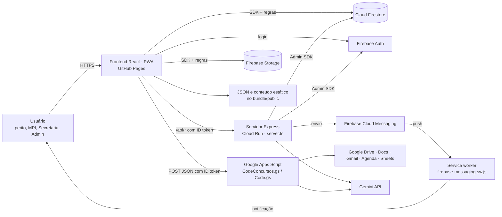
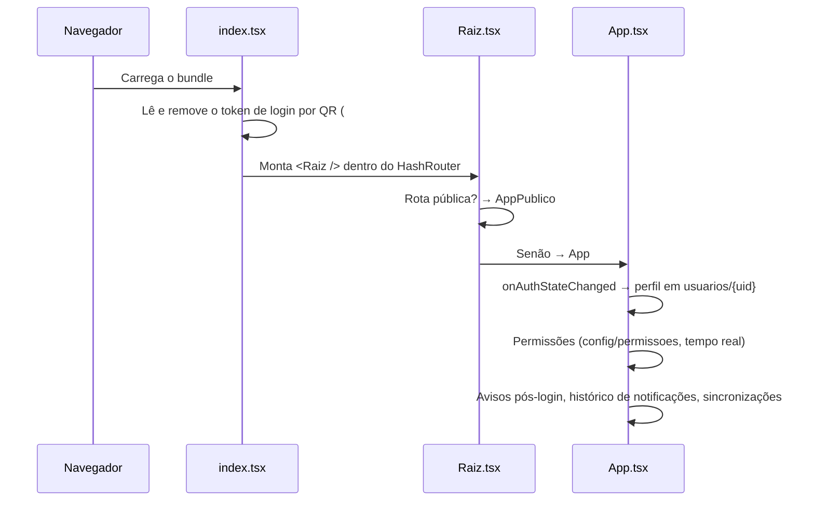
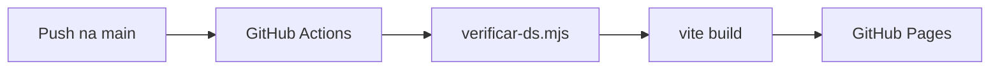
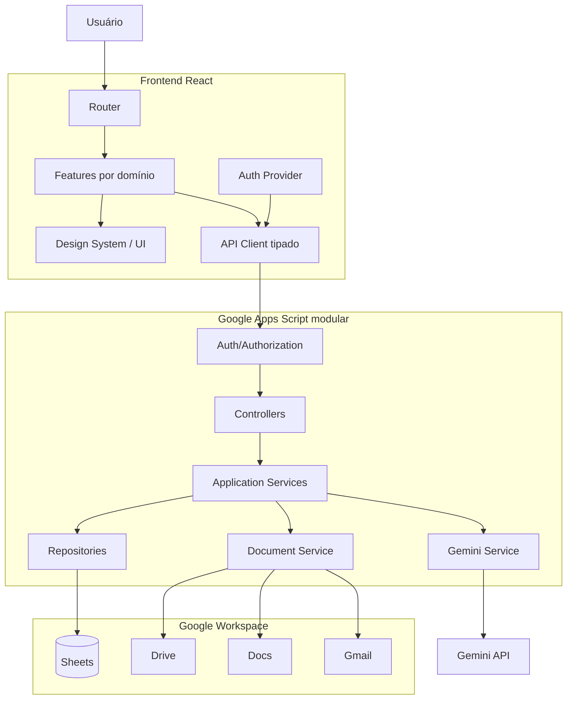

# Arquitetura do Sistema

## 1. Visão geral

> **Atualizado em 31/10/2026.**

O **Guia Médico Naval — JRS/HNRe** é uma aplicação web de página única (*Single Page Application* — SPA), instalável como PWA, voltada ao apoio das atividades médico-periciais da Junta Regular de Saúde do Hospital Naval de Recife.

A solução combina cinco grupos principais de capacidades:

1. **Consulta de conteúdo normativo e médico-pericial**, armazenado majoritariamente no próprio código-fonte (com páginas públicas, sem login, para as Doenças de Lei e a Portaria).
2. **Trabalho da JRS**: Inspeções de Saúde e agenda dos peritos, concursos (planilha de candidatos, triagem, exames, termos), pareceres, perícias menores e inspecionados, com dados no **Cloud Firestore**.
3. **Automação documental**, executada por Google Apps Script (`CodeConcursos.gs`) com Google Docs, Drive, Gmail e Google Agenda — inclusive o envio automático de documentos por e-mail para impressão.
4. **IA (Gemini)**: leitura de atestados (Apps Script), transcrição de mensagens e de exames de candidatos (Apps Script e servidor no Cloud Run).
5. **Notificações push** (Firebase Cloud Messaging), com histórico por usuário no app.

O frontend é publicado como site estático no GitHub Pages. O backend tem duas partes: um **servidor Node/Express no Cloud Run** (`server.ts`, com o Firebase Admin SDK) para o que exige credencial de servidor — operações de Admin, notificações, Gemini — e o **Apps Script** para a automação do Google Workspace. Os dados operacionais ficam no Firestore e no Storage, acessados direto pelo navegador e protegidos pelas regras versionadas em `firestore.rules` e `storage.rules`.

> **PWA:** o app tem manifesto (`public/manifest.webmanifest`, nome **JRS/HNRe App**), ícones e um *service worker* (`public/firebase-messaging-sw.js`) usado para o push. Não há cache offline.

---

## 2. Diagrama de contexto



---

## 3. Estilo arquitetural

### 3.1 Frontend

O frontend segue uma arquitetura de SPA baseada em componentes React, com roteamento por URL (`HashRouter`). `components/Raiz.tsx` decide entre o app autenticado (`App.tsx`) e as páginas públicas (`components/publico/`).

Características observadas:

- React 19 com TypeScript;
- Vite como ferramenta de desenvolvimento e *build*;
- componentes funcionais e Hooks;
- estado local com `useState`/`useEffect` e um `NavContext` com usuário, perfil, avisos e notificações;
- leitura em tempo real do Firestore (`onSnapshot`) nas telas de trabalho;
- roteamento por URL com `react-router-dom` (tabela em `config/routes.ts`; `NavItem` segue como identificador das permissões e a `currentView` é derivada da URL);
- estilos utilitários Tailwind compilados no build (PostCSS) com tokens do design system — classes fora do DS falham o build (`scripts/verificar-ds.mjs`);
- ícones Material Symbols (shim `components/ui/icons.tsx`);
- tela de erro (`components/ErroFatal.tsx`) no lugar de tela branca quando uma tela falha;
- conteúdo médico e normativo embutido em componentes e em `constants.ts`;
- dados auxiliares estáticos em `public/*.json`.

### 3.2 Backend

O backend tem duas partes, publicadas separadamente:

**Servidor no Cloud Run (`server.ts`, Node + Express, Firebase Admin SDK).** Todas as rotas exigem o *ID token* do Firebase no cabeçalho `Authorization` (salvo as de login), e as de Admin conferem o perfil no Firestore:

| Rota | Função |
|---|---|
| `POST /api/auth/handoff-token` | Token de login do desktop para o celular (QR code de "Instalar app") |
| `POST /api/auth/resolver-nip` | Login por NIP (devolve só o login e se a senha é temporária; limitado por IP) |
| `POST /api/admin/resetar-senha` | Admin volta a senha de um usuário à inicial |
| `POST /api/admin/excluir-usuario` | Admin apaga um usuário **inativo** (Auth + `usuarios` + `usuarios_publicos`) |
| `POST /api/admin/preview-apresentacao` | Título e capa de uma apresentação (Google Slides, Canva, GitHub Pages) |
| `POST /api/notificacoes/evento` | Recebe um evento (login, status Inapto/IDM, IS finalizada, teste), confere no Firestore, grava o histórico e envia o push |
| `POST /api/gemini/analyze-image` | Leitura de imagem pelo Gemini |
| `POST /api/concursos/ocr-pdf` | Transcrição literal do PDF de mensagem administrativa |

O mesmo servidor serve o build em desenvolvimento (`npm run dev`) e libera CORS para a origem do GitHub Pages (`ALLOWED_ORIGIN`).

**Google Apps Script.** `apps-script/concursos/CodeConcursos.gs` concentra a automação do Workspace: geração de PDFs por template (termos, pedidos de parecer, solicitações de exames), gravação no Drive, transcrição de exames e mensagens pelo Gemini, envio de e-mails para impressão e sincronização com o Google Agenda "JRS/HNRe". As ações que gravam exigem o `idToken` do Firebase. `apps-script/principal/Code.gs` mantém as funções legadas e as listas em planilha.

### 3.3 Persistência

O **Cloud Firestore** é a fonte principal (detalhes em `docs/database.md`, seções 32+). PDFs ficam no **Firebase Storage** (legislação, perícias menores, infográficos, fotos) ou no **Google Drive** (concursos, pareceres, exames de candidatos). As planilhas Google ficaram para o histórico e listas de apoio.

### 3.4 Integrações

- Firebase Authentication, Firestore, Storage e Cloud Messaging;
- Cloud Run (servidor `server.ts`);
- Google Apps Script Web App (Drive, Docs, Gmail, Agenda, Sheets);
- Gemini API (pelo Apps Script e pelo servidor);
- provedores de mídia: YouTube (vídeos), Google Slides/Canva/GitHub Pages (apresentações), Imgur.

---

## 4. Componentes de alto nível

| Componente | Responsabilidade | Tecnologia |
|---|---|---|
| `index.html` / `index.tsx` | Documento base, manifesto, montagem do React e leitura do token de login por QR | HTML + React DOM |
| `components/Raiz.tsx` | Desvio entre o app autenticado e as páginas públicas | React |
| `App.tsx` | Shell autenticado: sessão, permissões, avisos pós-login (senha, notificações, triagem), histórico de notificações | React + TypeScript |
| `components/shell/` | Sidebar, topbar, breadcrumb, busca global e menu do usuário (com badge de notificações) | React |
| `components/ui/` | Primitivos do design system (Dialog, Drawer, Button, StatusTag, Toast…) | React + Tailwind |
| `components/` (telas) | Início, Inspeções, Inspecionados, Concursos, Pareceres, Perícia Menor, Formação, Usuários, Perfil | React |
| `config/` | Rotas, navegação, matriz de permissões e endpoints | TypeScript |
| `services/` | Acesso ao Firestore/Storage, ao servidor e ao Apps Script; push | TypeScript |
| `utils/` | Regras puras (datas, minutas, triagem, exames, PWA) | TypeScript |
| `server.ts` | API do Cloud Run (Admin SDK, Gemini, notificações) | Node + Express |
| `public/firebase-messaging-sw.js` | Service worker do push | JavaScript |
| `apps-script/` | Automação do Google Workspace | Google Apps Script |
| `firestore.rules` / `storage.rules` | Autorização dos dados | Firebase Rules |
| GitHub Actions | Publicação do frontend (Pages) e do servidor (Cloud Run) | YAML |

---

## 5. Organização do repositório

```text
/
├── .github/workflows/
│   ├── deploy.yml               # frontend → GitHub Pages
│   └── deploy-cloud-run.yml     # server.ts → Cloud Run
├── apps-script/
│   ├── principal/Code.gs
│   └── concursos/CodeConcursos.gs
├── components/
│   ├── concursos/               # detalhe da IS, exames, triagem, calendário
│   ├── inspecoes/               # agenda, agendamento, bloqueios, minutas
│   ├── militares/ pareceres/ periciaMenor/
│   ├── publico/                 # páginas sem login
│   ├── shell/                   # sidebar, topbar, menu do usuário
│   ├── ui/                      # primitivos do design system
│   ├── Home.tsx, ConcursosJRS.tsx, Inspecoes.tsx, …
│   ├── NotificacoesConvite.tsx, NotificacoesPainel.tsx
│   └── ErroFatal.tsx
├── config/                      # routes, navigation, permissions, endpoints
├── context/  hooks/  utils/
├── services/                    # firestore*, drive*, notificacoesPush, documentosGerados…
├── public/
│   ├── manifest.webmanifest
│   ├── firebase-messaging-sw.js
│   ├── icons/                   # ícones das notificações
│   └── *.json                   # CID, serviços, finalidades, restrições, OMs…
├── scripts/                     # migrações e verificação do design system
├── docs/
├── server.ts
├── firestore.rules  storage.rules  firebase.json
├── App.tsx  index.tsx  index.html  constants.ts  types.ts
└── vite.config.ts  tailwind.config.js  package.json
```

### 5.1 Observação sobre a estrutura atual

A organização é funcional para o porte atual, mas mistura três categorias dentro de `components/`:

- componentes de layout;
- telas completas;
- conteúdo editorial estático.

Com o crescimento do projeto, essa estrutura tende a aumentar o acoplamento e dificultar a localização de regras específicas.

---

## 6. Arquitetura do frontend

### 6.1 Inicialização



`App.tsx` também lê, já no carregamento, o `?notif={id}` de quem abriu o app pelo push, para marcar a notificação como lida.

### 6.2 Navegação

- Rotas em `config/routes.ts` (ex.: `/inspecoes`, `/concursos/:concursoId`, `/concursos/dia/AAAA-MM-DD`, `/concursos/atrasadas`, `/pareceres`, `/extras/apresentacoes`). `HashRouter` por causa do GitHub Pages.
- Menu lateral por categorias (`config/navigation.ts`): **Trabalho**, **Consulta**, **Formação** e **Administração** (Admin).
- Cada página checa `canAccessPage` e mostra "acesso negado" quando o perfil não pode.
- Páginas públicas: `/publico/doencas` e `/publico/portaria`.

### 6.3 Estado

- `NavContext`: usuário (com o "Visualizar como" do Admin), perfil real, avisos, contagem de notificações não lidas, navegação e menus.
- Estado das telas: local, com assinaturas em tempo real do Firestore.
- `localStorage`: preferências por aparelho (acesso rápido, convite de notificações adiado, contagem do aviso de triagem, token do push, tutorial de instalação).

### 6.4 Camada de serviços

`services/` concentra o acesso a dados e integrações: um arquivo por coleção do Firestore (`firestore*.ts`), o Drive/Apps Script (`driveConcursos.ts`, `drivePareceres.ts`), a agenda (`agendaConcursos.ts`, `agendaGoogleIS.ts`), o push (`notificacoesPush.ts`), a fila de impressão (`documentosGerados.ts`) e a auditoria das IS (`auditoriaIS.ts`). A URL do servidor vem de `utils/apiBase.ts` e as do Apps Script de `config/endpoints.ts`.

### 6.5 Conteúdo e dados locais

- objetos TypeScript em `constants.ts` e conteúdo nos componentes (Doenças de Lei, normas);
- `public/*.json`: CID, serviços do HNRe, finalidades e restrições das IS, OMs, corpos e quadros.

### 6.6 Geração local de documentos

- `jsPDF`: PDF do atestado fotografado (Perícia Menor) e documentos do guia de doenças.
- `pdf-lib`: junção do Termo de Recurso com o Termo de Cientificação num PDF único.

### 6.7 Notificações e avisos

- `NotificacoesConvite` pede a permissão ao abrir o app (ou ensina a instalar no iPhone); `services/notificacoesPush.ts` registra o service worker, obtém o token e o grava em `tokens_push`.
- O histórico (`usuarios/{uid}/notificacoes`) alimenta o badge do avatar e o painel do menu do usuário.
- Fila de avisos pós-login: senha temporária → aviso da triagem (MPI, 3 primeiros acessos) → convite de notificações.

---

## 7. Módulos funcionais

### 7.1 Início
Painel de trabalho: *Precisa de atenção* (pareceres atrasados, perícias vigentes, IS de hoje, concursos em andamento e do dia, **IS de concurso atrasadas**, senha temporária), *Últimos documentos gerados* (só Secretaria), Próximas Inspeções, Pareceres não concluídos, Perícias Menores Vigentes, Acesso rápido, **Próximas férias** (coluna direita), Agenda de inspeções e Avisos.

### 7.2 Inspeções de Saúde e agenda
`Inspecoes.tsx` e `components/inspecoes/`: cadastro das IS (exceto concursos), tabela agrupada ou calendário Dia/Semana/Mês, agendamento por perito em slots (transação em `agendaSlots`), bloqueios de horário/turno/período, minutas e sincronização com o Google Agenda "JRS/HNRe" (Apps Script). Os dias de concurso ocupam o turno da manhã de todos os peritos.

### 7.3 Concursos
`ConcursosJRS.tsx` e `components/concursos/`:
- cards dos concursos com calendário dos dias agendados; páginas por dia (`/concursos/dia/…`) e de **IS atrasadas** (`/concursos/atrasadas`), com uma tabela por concurso;
- planilha de candidatos (status, observações/CID, Nº TIS e finalização; menu de ações; auditoria por IS);
- termos de recurso e de cientificação, pedidos de parecer e solicitações de exames (PDF no Drive), **enviados por e-mail para impressão** automaticamente;
- exames entregues pelo candidato (PDF + transcrição pelo Gemini);
- **triagem** pelo MPI (`Triagem.tsx`, `utils/triagem.ts`): botão TRIAR só nas IS do dia, alertas de possível inaptidão, TRIADO com seção na barra lateral.

### 7.4 Pareceres
Firestore (`pareceres`, `quesitosParecer`); PDF pelo Apps Script no Drive; diálogo **Enviar para Impressão** por e-mail.

### 7.5 Perícia menor
Firestore (`periciasMenores`); leitura do atestado pelo Gemini (Apps Script); PDF do atestado no Storage.

### 7.6 Inspecionados
`militares`: militares, dependentes e pensionistas; ficha com histórico das IS.

### 7.7 Consulta
Doenças de Lei (com calculadoras: CDR, Webster, Child-Pugh; tabela de classificação da SIDA/AIDS), exames e índices de concursos, DGPM-406, Portaria e Legislação (Firestore + PDFs no Storage).

### 7.8 Formação
Casos periciais, Vídeos (YouTube), Infográficos (Storage), **Apresentações** (Google Slides, Canva, GitHub Pages, abertas em tela cheia) e Roteiro. Cadastro pelo Admin; visualizações registradas em `visualizacoesExtras`.

### 7.9 Administração e perfil
Usuários (cadastro, permissões por perfil, redefinir senha, **excluir inativo**) e Perfil (contato, foto, senha e **Notificações**: status, ativação e envio de teste).

### 7.10 Mensagens
`Mensagens.tsx`: minutas de mensagens administrativas.

---

## 8. Arquitetura do backend Google Apps Script

> As subseções 8.1 a 8.6 descrevem o `Code.gs` principal (legado, planilhas). A automação atual está em `apps-script/concursos/CodeConcursos.gs`, com as ações: `criarEstruturaConcurso`, `salvarMensagemPdf`, `extrairMensagemConcurso`, `salvarPdfCandidato`, `salvarExamesCandidato`, `gerarTermoRecurso`, `gerarTermoCientificacao`, `gerarSolicitacaoParecer`, `gerarSolicitacaoExames`, `gerarPedidoParecer`, `salvarPdfParecer`, `gerarMinutaMensagem`, `removerArquivoDrive`, **`enviarTermoRecursoImpressao`**, **`enviarSolicitacaoConcursoImpressao`**, **`enviarParecerImpressao`** (e-mails para a impressão, com cópia para a Secretaria), `sincronizarEventoIS`, `sincronizarEventoBloqueio` e `sincronizarEventosConcursos` (Google Agenda).

### 8.1 Estrutura

O arquivo `Code.gs` contém:

- constantes com IDs de recursos;
- `doGet(e)`;
- funções auxiliares;
- `doPost(e)`;
- regras de geração e envio de documentos.

A seleção da operação é feita por um campo `action` recebido por query string ou no corpo JSON.

### 8.2 Operações GET observadas

Entre as operações implementadas ou consumidas pelo frontend estão:

| Ação | Finalidade |
|---|---|
| `login` | Validar credenciais do usuário |
| `getUsuarios` | Consultar usuários cadastrados |
| `createUsuario` | Criar solicitação ou registro de usuário |
| `getLookups` | Obter finalidades, postos, quadros, especialidades, dispensas, OM e peritos |
| `getMilitar` | Consultar um militar por NIP |
| `getMilitaresList` | Listar militares para busca/autocomplete |
| `getPareceresList` | Listar pareceres gerados |
| `getPericiaMenorList` | Listar perícias menores e calcular vigência |
| `getExtras` | Obter materiais extras de outra planilha |

> Algumas ações aparecem no consumo do frontend e outras no backend. A tabela consolida o contrato observado entre ambos.

### 8.3 Operações POST observadas

| Ação | Finalidade |
|---|---|
| `extrair_dados_atestado` | Enviar imagem ao Gemini e obter dados estruturados |
| geração de perícia menor | Criar documento, anexar imagem, exportar e registrar |
| geração de parecer | Copiar template, substituir marcadores, exportar e registrar |
| `imprimir` | Executar ação associada ao PDF gerado |
| geração de mensagem/minuta | Processar dados com Gemini e retornar texto estruturado |

### 8.4 Google Sheets como banco operacional

O backend utiliza abas de planilha como tabelas. Foram identificadas referências a:

- `ListasRef`;
- `OM`;
- `Perito`;
- `Militares`;
- `Templates_Documentos`;
- `Pareceres`;
- `Pericia_Menor`;
- abas relacionadas a usuários e templates adicionais.

A leitura é feita por `getDataRange().getValues()`, seguida por transformação manual de linhas e colunas.

### 8.5 Automação documental

O padrão de geração documental é:

1. localizar o template por tipo ou especialidade;
2. copiar o arquivo para uma pasta de destino;
3. abrir a cópia com `DocumentApp`;
4. substituir marcadores como `{{INSPECIONADO}}` e `{{FINALIDADE}}`;
5. inserir conteúdo e, quando aplicável, imagem;
6. salvar o documento;
7. exportar para PDF e/ou ODT;
8. registrar o resultado em planilha;
9. enviar por e-mail;
10. mover a cópia temporária do Google Docs para a lixeira.

### 8.6 Integração com Gemini

A chave da API Gemini é recuperada por:

```js
PropertiesService.getScriptProperties().getProperty("GEMINI_API_KEY")
```

Isso mantém a chave fora do frontend no fluxo observado de OCR. O backend envia à API:

- prompt textual;
- imagem JPEG em Base64;
- configuração de resposta JSON.

O modelo observado é:

```text
gemini-2.5-flash
```

---

## 9. Autenticação e autorização

### 9.1 Fluxo atual

- **Firebase Authentication** (e-mail/senha). O login é pelo *usuário* (ex.: `CT MAURISTON`) ou pelo NIP; cada usuário tem um e-mail sintético interno derivado do login (`services/firebaseAuth.ts`). O NIP é resolvido no servidor (`/api/auth/resolver-nip`).
- O perfil vem de `usuarios/{uid}` no Firestore; usuário inativo é deslogado.
- **Senha temporária**: diálogo pós-login pede a troca.
- **Login no celular por QR code**: o desktop pede ao servidor um *custom token* do próprio usuário e o coloca no fragmento da URL do QR.
- **Logout** apaga o token de push do aparelho antes de sair.

### 9.2 Perfis

| Perfil | Uso |
|---|---|
| `admin` | Presidente da JRS: acesso total, gestão de usuários e permissões, "Visualizar como" outro perfil |
| `user_medicos` | Peritos da JRS |
| `user_medicos_mpi` | Médicos da MPI (inclui a triagem das IS de concurso) |
| `user_secretaria` | Secretaria (agenda, cadastros, fila de impressão na Início) |

A visibilidade de páginas e funcionalidades segue a matriz `config/permissoes` (editável pelo Admin), lida por `canAccessPage`/`canUseFeature`.

### 9.3 Autorização dos dados

- **Firestore/Storage:** regras por perfil em `firestore.rules`/`storage.rules` (resumo em `docs/database.md`, seção 42). O perfil é lido do próprio Firestore nas regras.
- **Servidor:** cada rota verifica o ID token (`verifyIdToken(..., true)`) e, quando é de Admin, o perfil no Firestore.
- **Apps Script:** as ações que gravam no Drive ou usam o Gemini validam o `idToken` do Firebase (`exigirUsuarioFirebase`).

### 9.4 Limites de segurança atuais

- Boa parte das coleções de trabalho (concursos e candidatos) é gravável por qualquer usuário autenticado; o controle fino por perfil está só na UI.
- Não há validação de esquema no servidor para gravações feitas direto pelo cliente.
- A configuração pública do Firebase e a chave VAPID ficam no bundle (são públicas por natureza); segredos (Gemini, service accounts) ficam só no Apps Script e no Cloud Run.

## 10. Contratos de dados

### 10.1 Tipos centrais do frontend

`types.ts` define:

- `NavItem`;
- `Diagnosis`;
- `Disease`;
- `Law`.

Outros contratos são definidos localmente dentro dos componentes e serviços, como `AuthUser` e `ExtraItem`.

### 10.2 Formato padrão das respostas do GAS

O backend tende a retornar o seguinte envelope:

```json
{
  "success": true,
  "data": {}
}
```

Em caso de erro:

```json
{
  "success": false,
  "message": "Descrição do erro"
}
```

Não existe, no repositório, uma definição compartilhada ou esquema formal para esses contratos.

### 10.3 Validação

A validação ocorre de forma manual no frontend e no backend. Não foram identificadas bibliotecas de schema, como Zod, Yup ou JSON Schema.

---

## 11. Implantação

### 11.1 Frontend

Compilado pelo Vite e publicado no GitHub Pages por `.github/workflows/deploy.yml` a cada push na `main`.



- base pública do Vite: `/DoencasEPareceresJRS/`;
- variáveis de build (variáveis do repositório): `VITE_API_BASE_URL` (URL do Cloud Run) e `VITE_FIREBASE_VAPID_KEY` (chave pública do push).

### 11.2 Servidor (Cloud Run)

`.github/workflows/deploy-cloud-run.yml` publica `server.ts` no Cloud Run, no mesmo projeto Google Cloud do Firebase, quando ele (ou suas dependências) muda. A service account do serviço precisa de acesso ao Firestore, ao Auth (inclusive criar *custom tokens*) e ao Firebase Cloud Messaging.

### 11.3 Apps Script

Publicação **manual**, colando o código no editor e reimplantando a versão — ver `docs/apps-script-deploy.md`.

### 11.4 Regras do Firebase

`firestore.rules` e `storage.rules` são versionadas, mas publicadas à parte (console ou `firebase deploy --only firestore:rules`). **Uma regra nova só vale depois de publicada** — por exemplo, o histórico de notificações e a fila de impressão dependem dos blocos `usuarios/{uid}/notificacoes` e `documentos_gerados`.

### 11.5 Configuração de ambiente

- `firebase-applet-config.json`: configuração pública do cliente Firebase (também passada ao service worker pela URL do registro).
- Cloud Run: `GEMINI_API_KEY`, `ALLOWED_ORIGIN`, `APP_URL` e credenciais padrão do serviço.
- Apps Script: `GEMINI_API_KEY` nas propriedades do script.

---

## 12. Dependências externas

### 12.1 Dependências de produção

| Pacote | Uso |
|---|---|
| `react`, `react-dom`, `react-router-dom` | Interface e rotas |
| `firebase` | Auth, Firestore, Storage e Messaging no cliente |
| `firebase-admin`, `express` | Servidor no Cloud Run |
| `@google/genai` | Gemini no servidor |
| `jspdf`, `pdf-lib` | PDFs locais (atestado, junção de termos) |
| `react-image-crop` | Recorte de imagem de atestado |
| `marked` | Renderização de Markdown |
| `qrcode` | QR code de instalação/login no celular |

### 12.2 Dependências carregadas externamente

O `index.html` carrega externamente apenas o Google Material Symbols. Tailwind e a fonte Montserrat (`assets/fonts`) são empacotados no build; o antigo `importmap`/`esm.sh` foi removido e todas as dependências vêm do NPM.

### 12.3 Serviços externos

- Firebase (Auth, Firestore, Storage, Cloud Messaging);
- Google Cloud Run;
- Google Apps Script, Drive, Docs, Gmail, Agenda e Sheets;
- Gemini API;
- GitHub Pages e GitHub Actions;
- YouTube, Google Slides, Canva, Imgur;
- Google Fonts (Material Symbols) e gstatic (SDK do Firebase no service worker).

---

## 13. Qualidades arquiteturais

### 13.1 Pontos fortes

- **Baixo custo de infraestrutura:** GitHub Pages, Cloud Run (escala a zero), Firebase e Apps Script.
- **Dados em tempo real e com regras de acesso** (Firestore), com transação onde há concorrência (agendamento).
- **Integração nativa com Google Workspace** para documentos, e-mails e agenda.
- **Segredos fora do navegador:** Gemini e Admin SDK só no servidor/Apps Script.
- **Mobile-first e instalável**, com push e login no celular por QR code.
- **Rotas por URL** (deep links, botão voltar) e design system verificado no build.
- **Conteúdo de consulta resiliente**, compilado no bundle.

### 13.2 Limitações

- `ConcursosJRS.tsx` e `App.tsx` concentram muita lógica (componentes extensos);
- coleções de concursos graváveis por qualquer usuário autenticado (controle fino só na UI);
- sem validação de esquema no servidor para as gravações do cliente;
- regras do Firebase e Apps Script publicados à parte do código (podem ficar defasados);
- inexistência de testes automatizados;
- observabilidade limitada aos logs do Cloud Run e à auditoria das IS de concurso;
- sem *code splitting* por rota;
- sem cache offline.

---

## 14. Riscos técnicos

| Risco | Impacto | Probabilidade | Mitigação recomendada |
|---|---|---:|---|
| Regras do Firestore não publicadas após mudança no código | Alto | Média | Publicar as regras no mesmo fluxo do deploy (CI) |
| Gravação indevida em concursos por perfil sem permissão | Médio | Baixa | Restringir as regras por perfil/campo |
| Componentes muito extensos (`ConcursosJRS.tsx`) | Médio | Alta | Dividir por responsabilidade (tabela, sheet, ações) |
| Apps Script publicado manualmente | Médio | Média | Checklist de reimplantação; versionar o deploymentId |
| Falha ou cota do Apps Script/Gemini | Alto | Média | Tratar erros e manter o documento salvo mesmo sem e-mail |
| Push dependente da instalação no iOS | Baixo | Alta | Histórico no app (badge) independe do push |
| Ausência de testes | Alto | Alta | Testes unitários das regras puras (`utils/`) e E2E dos fluxos críticos |
| Dados médico-administrativos em serviços externos | Alto | Média | Revisar LGPD, acesso, retenção e auditoria |
| Dependências por CDN | Baixo | Baixa | Autohospedar Material Symbols e o SDK do service worker |

---

## 15. Recomendações de evolução

### 15.1 Prioridade crítica: autenticação e autorização

1. Escolher um único mecanismo de autenticação.
2. Preferir Firebase Authentication, Google Identity ou sessão emitida pelo backend.
3. Eliminar o armazenamento de hash de senha no `localStorage`.
4. Não transmitir credenciais por query string.
5. Validar perfil e permissão em cada ação do Apps Script.
6. Registrar tentativas de acesso e operações sensíveis.

### 15.2 Centralizar a API do frontend

Criar uma estrutura semelhante a:

```text
src/
└── services/
    ├── apiClient.ts
    ├── authService.ts
    ├── pareceresService.ts
    ├── periciaMenorService.ts
    └── extrasService.ts
```

O `apiClient.ts` deve centralizar:

- URL base;
- serialização;
- tratamento de erro;
- timeout;
- autenticação;
- envelope padrão de resposta.

### 15.3 Adotar roteamento real

Introduzir React Router com URLs estáveis, por exemplo:

```text
/doencas
/concursos
/exames
/pareceres
/pericia-menor
/normas/dgpm-406
/normas/hnre
/estudo
```

Benefícios:

- histórico do navegador;
- links diretos;
- atualização sem perda de contexto;
- carregamento sob demanda;
- melhor organização de permissões.

### 15.4 Reorganizar o frontend por domínio

Estrutura recomendada:

```text
src/
├── app/
│   ├── App.tsx
│   ├── router.tsx
│   └── providers.tsx
├── components/
│   ├── ui/
│   └── layout/
├── features/
│   ├── auth/
│   ├── beneficios/
│   ├── concursos/
│   ├── pareceres/
│   ├── pericia-menor/
│   ├── normas/
│   └── estudo/
├── services/
├── data/
├── types/
└── styles/
```

### 15.5 Modularizar o Apps Script

Sugestão de divisão:

```text
apps-script/
├── Main.gs
├── Config.gs
├── AuthController.gs
├── ParecerController.gs
├── PericiaMenorController.gs
├── MensagemController.gs
├── MilitarRepository.gs
├── LookupRepository.gs
├── DocumentService.gs
├── GeminiService.gs
├── MailService.gs
└── ResponseUtils.gs
```

No Google Apps Script, vários arquivos `.gs` pertencentes ao mesmo projeto são carregados no mesmo escopo, permitindo modularização sem alterar a plataforma.

### 15.6 Formalizar contratos

Definir DTOs para todas as operações:

```ts
interface ApiResponse<T> {
  success: boolean;
  data?: T;
  message?: string;
  code?: string;
}
```

Também é recomendável validar entradas e saídas com schemas.

### 15.7 Configuração

Mover para configuração central:

- URL do Apps Script;
- IDs de planilhas;
- IDs de pastas;
- IDs de templates;
- nomes de abas;
- modelo Gemini;
- e-mails de destino;
- flags de ambiente.

No Apps Script, preferir `PropertiesService`. No frontend, usar variáveis `VITE_*` quando apropriado.

### 15.8 Testes

Adicionar:

- Vitest para unidades frontend;
- React Testing Library para componentes;
- Playwright para fluxos críticos;
- funções puras testáveis para transformação de dados do GAS;
- ambiente de homologação com planilha e pasta separadas.

Fluxos prioritários para E2E:

1. login;
2. consulta de militar;
3. geração de parecer;
4. OCR de atestado;
5. geração de perícia menor;
6. controle de acesso por perfil.

### 15.9 Observabilidade

Implementar:

- logs estruturados por ação;
- identificador de correlação por requisição;
- registro de usuário, horário e resultado;
- mensagens de erro sem dados sensíveis;
- painel ou planilha de auditoria;
- alertas para falhas na geração de documentos e chamadas Gemini.

### 15.10 PWA real, caso seja um requisito

Adicionar:

- `manifest.webmanifest`;
- ícones locais em múltiplas resoluções;
- *service worker*;
- estratégia de atualização;
- cache apenas de conteúdo público e estático;
- exclusão explícita de respostas autenticadas e dados sensíveis do cache.

---

## 16. Arquitetura-alvo sugerida



### Princípios da arquitetura-alvo

- organização por domínio;
- autorização no servidor;
- contratos tipados;
- configuração externa;
- baixo acoplamento entre UI e API;
- serviços backend especializados;
- rastreabilidade de operações;
- testes dos fluxos críticos;
- preservação da integração com Google Workspace.

---

## 17. Decisões arquiteturais registradas

### ADR-001 — Frontend estático no GitHub Pages

**Status:** vigente.

**Decisão:** publicar a aplicação React compilada como conteúdo estático no GitHub Pages.

**Motivação:** baixo custo, simplicidade e integração direta com GitHub Actions.

**Consequência:** toda lógica sensível deve permanecer fora do frontend.

### ADR-002 — Google Apps Script como backend

**Status:** vigente.

**Decisão:** usar Google Apps Script como API e orquestrador.

**Motivação:** integração nativa com Sheets, Docs, Drive e Gmail.

**Consequência:** limites de execução e cotas do Apps Script precisam ser considerados.

### ADR-003 — Google Sheets como persistência operacional

**Status:** vigente.

**Decisão:** usar abas de planilha como tabelas de cadastro e registro.

**Motivação:** administração simples pelos usuários autorizados e integração imediata com Apps Script.

**Consequência:** o sistema fica acoplado a cabeçalhos, nomes de abas e consistência manual da planilha.

### ADR-004 — Conteúdo normativo compilado no frontend

**Status:** vigente.

**Decisão:** manter parte do conteúdo médico-pericial diretamente no código e em JSON local.

**Motivação:** leitura rápida e menor dependência de chamadas remotas.

**Consequência:** alterações de conteúdo exigem novo build e publicação.

### ADR-005 — Gemini acessado pelo backend

**Status:** vigente.

**Decisão:** encaminhar imagens para Gemini por meio do Apps Script.

**Motivação:** evitar exposição da chave de API no navegador e integrar o resultado ao fluxo documental.

**Consequência:** imagens transitam pelo backend Google Apps Script e devem ser tratadas conforme requisitos de privacidade e retenção.

---

### ADR-006 — Cloud Firestore como persistência principal

- **Status:** aceita (substitui a ADR-003 para os dados operacionais).
- **Decisão:** usuários, IS, concursos, pareceres, perícias, legislação, formação, notificações e fila de impressão no Firestore, acessado pelo cliente com regras por perfil.
- **Consequências:** tempo real e transações; a autorização passa a depender de `firestore.rules`, que precisam ser publicadas a cada mudança.

### ADR-007 — Servidor Node no Cloud Run para operações privilegiadas

- **Status:** aceita.
- **Decisão:** `server.ts` (Express + Admin SDK) para o que o cliente não pode fazer: tokens de login, operações de Admin, notificações e Gemini.
- **Consequências:** dois backends (Cloud Run e Apps Script), com deploys independentes.

### ADR-008 — Notificações por FCM com histórico no Firestore

- **Status:** aceita.
- **Decisão:** o cliente só avisa o evento; o servidor confere, evita repetição (`notificacoes_enviadas`), grava o histórico de cada destinatário e envia o push. Quem realiza o evento não recebe o próprio aviso.
- **Consequências:** o histórico (badge) funciona mesmo sem push; no iPhone o push exige o app instalado na Tela de Início.

### ADR-009 — Documentos dos concursos e pareceres no Google Drive

- **Status:** aceita.
- **Decisão:** PDFs gerados pelo Apps Script ficam no Drive compartilhado e são enviados por e-mail para a impressão; o app registra a fila em `documentos_gerados`.

---

## 18. Checklist para mudanças arquiteturais

Antes de incorporar uma nova funcionalidade, verificar:

- [ ] O domínio funcional está claramente identificado?
- [ ] A lógica sensível está no backend?
- [ ] A ação valida autenticação e autorização no servidor?
- [ ] O contrato da API está tipado e documentado?
- [ ] Os dados de entrada são validados?
- [ ] Não há segredo inserido no bundle do frontend?
- [ ] Coleções novas têm bloco em `firestore.rules`, e as regras foram **publicadas**?
- [ ] Mudanças no Apps Script foram reimplantadas (`docs/apps-script-deploy.md`)?
- [ ] IDs e URLs estão centralizados em configuração?
- [ ] A mudança evita acoplamento direto a índices fixos de planilha?
- [ ] Há tratamento de erro e estado de carregamento?
- [ ] Há registro de auditoria para operação sensível?
- [ ] O fluxo foi testado em desktop e mobile?
- [ ] O impacto em cotas do Apps Script foi avaliado?
- [ ] O tratamento de dados está compatível com a LGPD e as normas institucionais?
- [ ] A documentação técnica foi atualizada?

---

## 19. Resumo executivo

A arquitetura evoluiu de "SPA + Apps Script + planilhas" para **SPA instalável + Firebase (Auth, Firestore, Storage, Messaging) + servidor no Cloud Run + Apps Script para o Google Workspace**. Das recomendações anteriores, já foram adotadas: autenticação por identidade (Firebase Auth), autorização por regras no banco e no servidor, roteamento por URL, camada de serviços, configuração externa (variáveis do CI e do Cloud Run) e auditoria das IS de concurso.

Os próximos passos de maior retorno são:

1. publicar as regras do Firebase no CI, junto do deploy;
2. restringir por perfil as gravações em concursos;
3. dividir os componentes mais extensos (`ConcursosJRS.tsx`);
4. testes automatizados das regras puras (`utils/`) e dos fluxos críticos;
5. *code splitting* por rota;
6. observabilidade (erros do cliente e do servidor).

---

## 20. Histórico de mudanças (19 a 31/10/2026)

| Data | Mudança | Onde |
|---|---|---|
| 19/10 | Inspeções de Saúde: tabela, calendário, agendamento por perito, bloqueios, Google Agenda | `Inspecoes.tsx`, `components/inspecoes/` |
| 19/10 | Dias de concurso no calendário e no Google Agenda (turno da manhã) | `services/agendaConcursos.ts` |
| 19/10 | Início como painel (Próximas Inspeções, IS de hoje, mini calendário) | `Home.tsx` |
| 21/10 | Páginas públicas das Doenças de Lei e da Portaria | `components/publico/` |
| 22/10 | Exames do candidato em PDF com transcrição pelo Gemini | `components/concursos/ExamesCandidato.tsx` |
| 24/10 | Excluir usuário inativo | `/api/admin/excluir-usuario` |
| 25/10 | Detalhes da IS com exames enviados | `CandidatoDetalhe.tsx` |
| 30/10 | Vídeos e Infográficos no Firebase; página Apresentações; Próximas férias | `services/firestoreExtras.ts` |
| 30–31/10 | Doenças de Lei: Webster, Child-Pugh, SIDA/AIDS, Cardiopatia isquêmica pós-IAM | `components/sections/` |
| 31/10 | Envio por e-mail para impressão (parecer, termos, solicitações) | `CodeConcursos.gs` |
| 31/10 | Tela de erro no lugar de tela branca | `ErroFatal.tsx` |
| 31/10 | Notificações push, histórico e badge; app "JRS/HNRe App" | `notificacoesPush.ts`, `server.ts` |
| 31/10 | Fila de documentos gerados (Secretaria) | `services/documentosGerados.ts` |
| 31/10 | Triagem das IS de concurso (MPI) | `components/concursos/Triagem.tsx` |
| 31/10 | IS de concurso atrasadas (Início e `/concursos/atrasadas`) | `Home.tsx`, `ConcursosJRS.tsx` |
