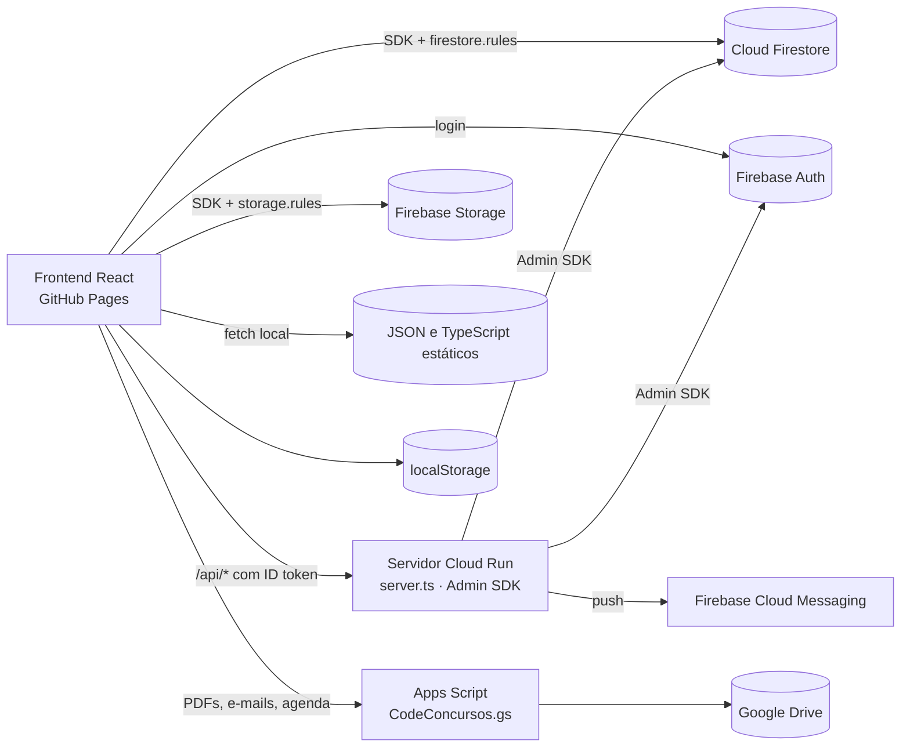

# Banco de Dados

## 1. Visão geral

> **Atualizado em 31/10/2026.** A fonte dos dados operacionais é o **Cloud Firestore** do projeto Firebase `jrs-app-web`. A antiga planilha principal do Google Sheets (abas `ListasRef`, `OM`, `Perito`, `Militares`, `Templates`, `Templates_Documentos`, `Pareceres`, `Pericia_Menor` e `Usuarios`) e a planilha de conteúdos extras **não são mais usadas pelo app**: os dados foram migrados para o Firestore e o código que as lia foi removido do repositório.

A persistência do **Guia Médico Naval — JRS/HNRe** está distribuída entre:

1. **Cloud Firestore** — banco principal: usuários, inspecionados, Inspeções de Saúde e agenda, concursos e candidatos (com exames, triagem e auditoria), pareceres, perícias menores, legislação, conteúdos de formação, notificações e a fila de impressão;
2. **Firebase Storage** — PDFs da legislação e das perícias menores, imagens dos infográficos e fotos de perfil;
3. **Google Drive** (via Apps Script `CodeConcursos.gs`) — PDFs dos concursos, dos pedidos de parecer e dos exames dos candidatos;
4. **Firebase Authentication** — contas de login (e-mail sintético derivado do usuário; ver `services/firebaseAuth.ts`);
5. **JSON e TypeScript estáticos** — catálogos (`public/*.json`) e conteúdo normativo no bundle;
6. **`localStorage`** — preferências por aparelho (acesso rápido, convite de notificações adiado, aviso de triagem, token do push).

O acesso ao Firestore é feito direto do navegador pelo SDK do Firebase, protegido pelas regras em `firestore.rules` (versionadas no repositório e publicadas no console ou com `firebase deploy --only firestore:rules`). O servidor no Cloud Run (`server.ts`, Firebase Admin SDK) só escreve o que o cliente não pode: notificações, controle de repetição e operações de Admin.

> **Constatação:** o Firestore resolveu boa parte das limitações do modelo em planilha (identificadores únicos, transações no agendamento, leitura em tempo real e regras de acesso por perfil). Continuam sem esquema formal, migrações versionadas ou validação no servidor para a maioria das coleções — a validação é feita nas telas.

---

## 2. Diagrama geral de persistência



---

## 3. Fontes de dados

| Fonte | Tipo | Finalidade | Escrita | Autoridade atual |
|---|---|---|---:|---|
| Cloud Firestore | Banco de documentos | Dados operacionais (seções 4 a 14) | Sim (cliente e servidor) | **Fonte principal** |
| Firebase Storage | Arquivos | PDFs da legislação e perícias menores, infográficos, fotos | Sim | Fonte dos arquivos citados |
| Google Drive | Arquivos (via Apps Script) | PDFs dos concursos, pareceres e exames de candidatos | Sim | Fonte desses PDFs |
| Firebase Authentication | Identidade | Contas de login | Sim (cliente e Admin SDK) | Fonte das contas |
| `public/*.json` | JSON estático | CID, serviços do HNRe, finalidades e restrições das IS, OMs, corpos e quadros | Não em runtime | Fonte local de consulta |
| `constants.ts` e componentes | TypeScript | Conteúdo normativo e de doenças | Não em runtime | Versionado no Git |
| `localStorage` | Navegador | Preferências por aparelho | Sim | Só daquele aparelho |

---

## 4. Pareceres no Firestore (substitui o histórico em planilha)

A página **Pareceres** deixou de usar a planilha/Apps Script principal. Os dados ficam no Firestore:

| Coleção | Documento | Conteúdo |
|---|---|---|
| `pareceres` | id automático, um por pedido | `militarId` (NIP só dígitos = id em `militares`), `inspecionado` (cópia do texto usado no pedido), `especialidade`, `finalidade`, `historico`, `quesitos[]`, `pdfUrl`, `status` (`solicitado` \| `concluido`), `solicitanteUid/Nome/Posto`, `criadoEm`, `concluidoEm`, `concluidoPor` |
| `quesitosParecer` | slug da especialidade (ex.: `psiquiatria`) | `especialidade` (maiúsculas) e `quesitos[]` — modelos sugeridos; edição só do Admin |

Decisões:
- **Coleção na raiz**, e não subcoleção do militar: permite listar/filtrar todos os pedidos (status, especialidade) sem `collectionGroup`, e o pedido (documento histórico) sobrevive à exclusão do cadastro. O vínculo é `militarId`, que a Perícia Menor também poderá usar.
- **Status "atrasado" é derivado**: `solicitado` há 20 dias ou mais (`PRAZO_ATRASO_DIAS` em `services/firestorePareceres.ts`). Nada gravado precisaria de rotina agendada para virar "atrasado".
- **PDF**: gerado pelo Apps Script standalone (`CodeConcursos.gs`, ação `gerarPedidoParecer`, template Google Docs `ID_TEMPLATE_PEDIDO_PARECER`) e guardado no **Google Drive** (pasta `PARECERES`, id `176YQTOO…`, subpasta com o nome completo do inspecionado, arquivo `SOL_PARECER_{especialidade sem acentos}_{DDMMMAAAA}.PDF`) pela ação `salvarPdfParecer`; o `pdfUrl` no Firestore é a URL de visualização (`/view`) do Drive, aberta numa nova janela (desktop e mobile) (pareceres antigos mantêm a URL do Storage `pareceres/{id}.pdf`).
- Carga inicial dos quesitos: `scripts/migrar-quesitos-parecer.mjs` (dados em `scripts/quesitos-parecer.json`).

## 5. Perícias Menores no Firestore

A página **Perícia Menor** deixou de usar a aba `Pericia_Menor` e a Guia de Encaminhamento (Google Docs). Os dados ficam no Firestore:

| Coleção | Documento | Conteúdo |
|---|---|---|
| `periciasMenores` | id automático (as migradas: `planilha-LINHA`) | `militarId` (NIP só dígitos = id em `militares`), `inspecionado`, `om`, `servico`, `cid`, `dispensas[]`, `dataAtestado` (AAAA-MM-DD), `tempoAtestado`, `tempoHomologado`, `dataTermino`, `vdf` (boolean), `peritoUsuario/Nome/Uid` (médico que registrou), `pdfUrl`, `criadoEm` |

Decisões:
- **`dataTermino`** = `dataAtestado` + `tempoHomologado` − 1 (o dia do atestado conta como o 1º), calculada ao gravar.
- **Status derivado**, não gravado: **Vigente** enquanto hoje ≤ `dataTermino`; depois, **Concluída** (`statusPericia` em `services/firestorePericiasMenores.ts`).
- **PDF do atestado**: a foto recortada vira PDF no navegador (`utils/imagemParaPdf.ts`) e vai ao Storage em `periciasMenores/{id}.pdf`. A leitura por IA continua na ação `extrair_dados_atestado` (Gemini, Apps Script).
- **Serviço do HNRe** vem de `militares.servico_label` e só é exibido e gravado (`servico`) para militares da OM HNRe; médicos podem gravar só esse campo no cadastro (regra do Firestore).
- Carga do histórico: `scripts/migrar-pericias-menores.mjs` (dados em `scripts/pericias-menores.json`).

## 6. PDFs dos concursos no Google Drive

Os PDFs ligados aos concursos (mensagens, termos de recurso/cientificação, pedidos de parecer e solicitações de exames) **não ficam mais no Firebase Storage**: são gravados no drive compartilhado, pasta raiz `CONCURSOS` (id `1eBTehJDTOPjsgOeP3DjWKbE-iXdIKGos`), pelo Apps Script standalone (`CodeConcursos.gs`) via `services/driveConcursos.ts`:

```
CONCURSOS/
  {ano}/                       ano da criação do concurso
    {nome do concurso}/
      CANDIDATOS/{nome do candidato}/{tipoDocumento}_{matrícula}_{AAAAMMDD-HHMMSS}.pdf
      CANDIDATOS/{nome do candidato}/EXAMES_{NOME_DO_CANDIDATO}.pdf
      MENSAGENS/{timestamp}_{arquivo}.pdf
```

- As pastas são criadas à medida que são necessárias (ano, concurso, CANDIDATOS e MENSAGENS na criação do concurso; a pasta do candidato ao gerar o primeiro documento).
- `tipoDocumento`: `termoRecurso`, `termoCientificacao`, `solicitacaoParecer`, `solicitacaoExames`.
- No Firestore continuam as mesmas URLs (`termoRecursoUrl`, `termoCientificacaoUrl`, `solicitacoesParecer[].url`, `solicitacoesExames[].url`, `mensagens/{id}.fileUrl`), agora do Drive: visualização (`https://drive.google.com/file/d/…/view`), tanto para os documentos do candidato quanto para as mensagens; os botões abrem a URL numa nova janela. URLs antigas do Storage continuam válidas.
- Ao apagar/regerar um termo, o arquivo do Drive vai para a lixeira (só arquivos sob a pasta raiz); URLs antigas do Storage são apagadas do Storage.
- As ações do script que gravam no Drive ou usam o Gemini exigem o `idToken` do Firebase (validado em `exigirUsuarioFirebase`).
- A transcrição e os dados da mensagem (cabeçalho, texto, período, candidatos) são lidos pelo Gemini (`extrairMensagemConcurso`, chave `GEMINI_API_KEY` nas propriedades do script) e gravados no Firestore como antes.

### Exames entregues pelo candidato

Os exames que o candidato apresenta na IS de Ingresso são enviados em PDF pelo app e seguem a **mesma lógica de pasta** dos termos e das solicitações (pasta do candidato, dentro de `CANDIDATOS`), mas com nome próprio: `EXAMES_{NOME_COMPLETO_SEM_ACENTOS}.pdf` (ex.: `EXAMES_JOSE_DA_SILVA_JUNIOR.pdf`). Um segundo PDF do mesmo candidato ganha sufixo (`_2`, `_3`…) — nada é sobrescrito.

A ação `salvarExamesCandidato` (`CodeConcursos.gs`) faz as duas coisas numa chamada só (o PDF escaneado sobe uma vez): grava o arquivo no Drive e manda o Gemini transcrever os laudos (`PROMPT_EXAMES_CANDIDATO`). Se a leitura falhar, o PDF continua salvo e a resposta traz `erroExtracao` — o app grava o link de qualquer forma.

A transcrição estruturada vai para uma subcoleção, um documento por PDF enviado:

| Coleção | Documento | Conteúdo |
|---|---|---|
| `concursos/{id}/candidatos/{matrícula}/exames` | id automático | `pdfUrl`, `nomeArquivo`, `paciente` (`nome`, `dataNascimento`, `cpf`, `identidade`), `exames[]`, `observacoes[]`, `quantidade`, `criadoEm` (ISO), `criadoPorNome` |

Cada item de `exames[]`: `ordem`, `categoria`, `nome`, `paciente`, `emissor`, `conselho`, `data`, `itens[]` (`{ nome, valor }`), `resultado` e `texto`. As categorias e as regras de cópia ficam em `utils/examesCandidato.ts`:

- `hemograma`, `eas`, `bioquimica` — um objeto cada, com um item por analito, **só o valor, sem unidade de medida** (plaquetas em milhares); valores repetidos em laudos de datas diferentes usam o mais recente, e o emissor/data do bloco é o do laudo mais recente. Na tela, cada analito é copiado separadamente e o emissor fecha o bloco.
- `betaHcg`, `vdrl`, `antiHiv` — resultado e emissor são copiados **juntos**; no anti-HIV o método entra no nome.
- `imagem`, `colpocitologia`, `ecg`, `toxicologico` e `outro` — laudo integral em `texto` (sem cabeçalho/rodapé da clínica). O texto copiado começa por `# NOME DO EXAME` e uma linha em branco, e termina com o emissor; o `#` fica só no texto copiado, não no título do card.

No documento do candidato ficam só o resumo que a tabela usa (`examesQtd`, `examesPdfUrls[]`, `examesEnviadoEm`) — a transcrição inteira não é lida ao listar os candidatos. `examesQtd` é o badge do botão de exames na coluna *Ações*, que abre a tela cheia com os blocos. **Limpar IS** (Admin) apaga a subcoleção e manda os PDFs para a lixeira do Drive.

Regras do Firestore: `concursos/{id}/candidatos/{matrícula}/exames/{id}` — leitura para qualquer usuário autenticado; criação por quem tem a funcionalidade `concursosJRS.enviarExamesCandidato`; edição e exclusão só do Admin.

---

## 7. Legislação no Firestore + PDFs no Storage

A página **Legislação** lê a coleção `legislacao` (migrada da aba `NORMAS` da planilha `17Dl5d3C…`) e abre o PDF de cada norma, do Firebase Storage, num modal em tela cheia.

| Campo | Descrição |
| --- | --- |
| id do documento | slug da norma (ex.: `lei-6880-1980`) |
| `ordem` | posição na lista |
| `legislacao` | identificação curta (ex.: `LEI nº 6.880/1980`) |
| `titulo` | título amigável |
| `providencias` | ementa (botão ⓘ) |
| `imageUrl` | brasão/logotipo exibido no card |
| `pdfPath` | caminho no Storage (`legislacao/{id}.pdf`) ou `null` se ainda não enviado |

Regras: Firestore — leitura autenticada, escrita só Admin; Storage (`legislacao/*`) — leitura autenticada, escrita só do Admin (perfil lido do Firestore), PDF até 25 MB. O botão **Novo** da página (só Admin) abre uma sidebar que envia o PDF para `legislacao/{id}.pdf` e cria o documento (id = slug da identificação).

---

## 8. Usuários, inspecionados e permissões no Firestore

| Coleção | Documento | Conteúdo |
|---|---|---|
| `usuarios` | UID do Firebase Auth | `usuario` (login, ex.: `CT MAURISTON`), `nome`, `postoGraduacao`, `cargo`, `nip`, `crmPe`, `rqe`, `email`, `gmail`, `celular`, `perfil` (`admin` \| `user_medicos` \| `user_medicos_mpi` \| `user_secretaria`), `ativo`, `imageProfile`, `senhaTemporaria`, `pwaTutorialConcluido` |
| `usuarios_publicos` | UID | Réplica mínima (`usuario`, `ativo`) para o menu de login, legível sem autenticação |
| `config/permissoes` | documento único | Matriz de páginas e funcionalidades por perfil (editada pelo Admin em *Usuários*) |
| `militares` | NIP só dígitos | Inspecionados (página *Inspecionados*): `tipo` (militar, dependente ou pensionista; dependente traz `titularId/Nome/Posto`), `om`, `temporario`, `pgq`, `nip`, `nome`, `inspecionado` (`{pgq} {nip} {nome}`), `email`, `ativo`, `rm1`, `refo`, `servico_label` (só HNRe), `nomeGuerra` e `especialidade` (oficiais médicos do HNRe) |

- O próprio usuário só altera e-mail, Gmail, celular, foto, `senhaTemporaria` e `pwaTutorialConcluido`. Perfil, nome, NIP e cargo só o Admin altera.
- **Excluir usuário** (Admin, só usuários **inativos**): o servidor (`/api/admin/excluir-usuario`) apaga a conta no Auth e os documentos em `usuarios` e `usuarios_publicos`. **Redefinir senha** (`/api/admin/resetar-senha`) volta à senha inicial e marca `senhaTemporaria`.

## 9. Inspeções de Saúde e agenda dos peritos

| Coleção | Documento | Conteúdo |
|---|---|---|
| `inspecoes` | nº da IS (só dígitos) — garante número único | `is`, `dataAbertura` (AAAA-MM-DD), `dataEntrevista` (AAAA-MM-DDThh:mm ou vazio), `finalidade`, `grupoFinalidade`, `amp` (`JRS` \| `MPI`), `peritoUid/Nome/Gmail`, `inspecionadoId` (NIP = id em `militares`), `inspecionado` (texto copiado), `situacao`, `status`, `dataLaudo`, `laudo`, `observacoes`, `restricoes`, `tis` (`AAA.000.N…`), `ds1a`, `minutaCancelamento?`, `eventoAgendaId?`, `agendaSincronizada?`, `criadoPor`, `criadoEm`, `atualizadoEm` |
| `agendaSlots` | `{peritoUid}__{AAAA-MM-DD}T{hh-mm}` | Um documento por horário ocupado. É gravado na **mesma transação** do agendamento, que reserva o slot novo e libera o anterior, então dois usuários nunca ocupam o mesmo horário do mesmo perito |
| `bloqueiosAgenda` | id automático | `data`, `dataFim?` (bloqueio de período, dia inteiro), `turno` (`manha` \| `tarde` \| `dia`), `hora?`, `peritoUid` (`*` = todos), `peritoNome?`, `motivo`, `eventoAgendaId?` |
| `config/agendaIS` | documento único | Turnos em que cada perito atende, por dia da semana (só o Admin grava) |

- **Status derivados**, não gravados: IS **Atrasada** (aberta sem entrevista há mais de 7 dias; 60 dias no grupo *Benefícios*).
- **Próximas férias** da Início: bloqueios com motivo contendo "FÉRIAS" (sem distinguir acento/caixa) ainda não terminados.
- Os **dias de concurso** não são gravados como bloqueio: são derivados dos candidatos (seção 10) e ocupam o turno da manhã de todos os peritos.

## 10. Concursos e candidatos

| Coleção | Documento | Conteúdo |
|---|---|---|
| `concursos` | slug do concurso (ex.: `CPAEAM-2026`) | `nome`, `status` (`em_breve` \| `em_andamento` \| `encerrado`; só o Admin altera), `dataHoraMensagemInicial`, `assuntoMensagemInicial`, `periodoInicioISO`, `periodoFimISO`, `totalCandidatos`, `criadoEm` |
| `concursos/{id}/candidatos` | matrícula | `nome`, `dataAgendamento` (AAAA-MM-DD), `status` (vazio, `Pendente`, `APTO`, `INAPTO`, `FALTOU`, `INSUF DOCUMENTAL`, `Reagendado`), `observacoes`, `numTIS`, `finalizado`, `dataLaudo`, `laudo`, `recurso`, `termoRecursoUrl`, `termoCientificacaoUrl`, `solicitacoesParecer[]` e `solicitacoesExames[]` (`{ url, rotulo, criadoEm }`), `examesQtd`, `examesPdfUrls[]`, `examesEnviadoEm`, **`triagem`** (abaixo) |
| `…/candidatos/{matrícula}/exames` | id automático | Transcrição dos exames entregues (ver seção 6) |
| `…/candidatos/{matrícula}/eventos` | id automático | Auditoria da IS: `acao`, `detalhe`, `uid`, `usuario`, `nome`, `em`. Qualquer usuário grava em seu nome; só o Admin lê; ninguém edita nem apaga |
| `concursos/{id}/mensagens` | id automático | Mensagens administrativas arquivadas (`dataHora`, `fileUrl`, `proposito`, `sender`, `recipient`, `info`, `subject`, `texto`) |
| `concursos/{id}/agendamentos` | AAAA-MM-DD | Datas do calendário de agendamento (`diaSemana`) |

**Finalização:** `finalizado` vira `true` quando a IS tem status com laudo, Nº TIS e, para INAPTO ou INSUF DOCUMENTAL, Observações (`candidatoEstaFinalizado` em `utils/concursosUtils.ts`). A IS finalizada não aceita mais edição pelo app.

**IS atrasada** (derivada, não gravada): `dataAgendamento` anterior a hoje e `finalizado == false`, nos concursos Em andamento ou Em breve. Alimenta o item da Início e a página `/concursos/atrasadas`.

**Triagem** (`candidatos/{matrícula}.triagem`, gravada pelo `user_medicos_mpi`):

| Campo | Formato |
|---|---|
| `altura` | texto `d,dd` (m), ex.: `1,75` |
| `peso`, `pas`, `pad`, `fc` | 2 ou 3 dígitos (kg, mmHg, mmHg, bpm) |
| `snellenSC`, `snellenCC` | só o denominador do Snellen (`20/xxx`), 2 ou 3 dígitos; `snellenCC` pode ser vazio |
| `ishiharaErros` | 0 a 15 (placas fixas em 15) |
| `entrevista`, `exameClinico`, `exames` | `{ alterado: boolean, texto: string }` |
| `atualizadoEm`, `atualizadoPor` | ISO e login de quem salvou |

- O IMC **não é gravado**: é calculado de `peso` e `altura`. Os alertas de possível inaptidão também são calculados (`utils/triagem.ts`).
- Salvar a triagem registra o evento "Triagem registrada/alterada" na auditoria. **Limpar IS** (Admin) apaga a triagem (`deleteField`), além de status, laudo, documentos e exames.

## 11. Formação: vídeos, infográficos, apresentações e casos periciais

| Coleção | Documento | Conteúdo |
|---|---|---|
| `videos` | id do vídeo no YouTube | `youtubeId`, `titulo` (oEmbed do YouTube), `thumbnailUrl`, `criadoPor`, `criadoEm` |
| `infograficos` | id automático | `titulo`, `imagePath` (Storage `infograficos/{id}.{ext}`), `imageUrl`, `criadoPor`, `criadoEm` |
| `apresentacoes` | id automático | `url`, `plataforma` (Google Slides, Canva, GitHub Pages), `titulo` e `thumbnailUrl` (lidos pelo servidor em `/api/admin/preview-apresentacao`), `criadoPor`, `criadoEm` |
| `visualizacoesExtras` | `{tipo}__{itemId}__{uid}` | Quem abriu cada item e quantas vezes (`vezes`, `ultimaEm`, `nome`). Cada usuário grava só o próprio registro; só o Admin lê |
| `casos_periciais_resultados` | UID | Último resultado do teste *Casos Periciais* (`respostas[]`, `acertos`, `total`, `nota`); cada usuário lê e grava só o próprio |

Vídeos e infográficos vinham de uma planilha de extras, que deixou de ser usada; o cadastro agora é pelo Admin, na própria página.

## 12. Notificações push

| Coleção | Documento | Conteúdo |
|---|---|---|
| `tokens_push` | token do FCM (um por aparelho/navegador) | `uid`, `usuario`, `plataforma` (user agent), `atualizadoEm`. O dono grava e apaga; ninguém lê pelo app. Apagado no logout |
| `usuarios/{uid}/notificacoes` | id do envio (o mesmo para todos os destinatários) | `titulo` (tipo do aviso), `corpo`, `rota` (tela do app aberta ao tocar), `lida`, `em`. Só o servidor cria; o dono lê e só altera `lida` |
| `notificacoes_enviadas` | chave do evento (ex.: `inapto_{concurso}_{matrícula}_{data}`, `dia_{concurso}_{data}`, `login_{uid}`) | Controle de repetição. Só o servidor lê e grava |

O cliente só avisa o servidor (`/api/notificacoes/evento`); o servidor confere o evento no Firestore, grava o histórico de cada destinatário e envia o push. O link do push traz `?notif={id}`, e o app marca a notificação como lida ao abrir.

## 13. Fila de impressão da Secretaria

| Coleção | Documento | Conteúdo |
|---|---|---|
| `documentos_gerados` | id automático | `tipo` (`termo-recurso`, `termo-cientificacao`, `solicitacao-parecer`, `solicitacao-exames`, `pedido-parecer`), `titulo`, `detalhe` (candidato/inspecionado e concurso), `pdfUrl`, `remetente`, `criadoPorUid`, `criadoEm`, `aberto`, `abertoEm`, `abertoPor` |

- Registrado ao gerar ou enviar para impressão os documentos com automação de e-mail e o Termo de Cientificação de Resultado (best-effort).
- A Início da Secretaria lista os não abertos (`where('aberto', '==', false)`, ordenados no cliente, sem índice composto). Abrir o PDF marca `aberto = true`.
- Regras: qualquer usuário cria em seu nome, sempre com `aberto == false`; Secretaria e Admin leem e só alteram `aberto/abertoEm/abertoPor`; só o Admin apaga.

## 14. Resumo das regras de acesso (`firestore.rules`)

| Coleção | Leitura | Escrita |
|---|---|---|
| `usuarios` | autenticado | Admin; o próprio usuário só os campos de contato, foto e flags |
| `usuarios_publicos` | pública | Admin ou o próprio usuário |
| `usuarios/{uid}/notificacoes` | o dono | servidor cria; o dono só marca `lida` |
| `tokens_push` | ninguém | o dono (`uid` = usuário logado) |
| `notificacoes_enviadas` | ninguém | ninguém (só o servidor) |
| `documentos_gerados` | Secretaria e Admin | criar: autenticado em seu nome; marcar aberto: Secretaria e Admin; apagar: Admin |
| `militares` | autenticado | criar: equipe; editar: Admin (médicos só `servico_label`); apagar: Admin |
| `inspecoes`, `agendaSlots` | autenticado | equipe (Admin, médicos, Secretaria); apagar IS: Admin |
| `bloqueiosAgenda` | autenticado | Admin e Secretaria; médico só os próprios |
| `pareceres` | autenticado | médicos criam; não-Admin só altera o status de conclusão |
| `periciasMenores` | autenticado | médicos criam; Admin edita e apaga |
| `concursos` e subcoleções | autenticado | por funcionalidade da matriz `config/permissoes` e por campo (abaixo); exclusão só Admin; eventos só criação, leitura do Admin |
| `legislacao`, `videos`, `infograficos`, `apresentacoes`, `quesitosParecer`, `config` | autenticado | Admin |
| `visualizacoesExtras` | Admin | o próprio registro |
| `casos_periciais_resultados` | o dono | o dono |

### Concursos: regras por funcionalidade e por campo

As regras leem a **mesma matriz** da tela (`config/permissoes`, `features[id][perfil]`), com os padrões de `DEFAULT_FEATURE_PERMISSIONS` (`config/permissions.ts`) quando o Admin não alterou a célula — **ao mudar um padrão no código, mude também em `firestore.rules`**. O Admin pode tudo. Cada atualização de candidato só pode mexer nos campos de uma ação:

| Ação (função em `services/firestoreConcursos.ts`) | Funcionalidade | Campos |
|---|---|---|
| Editar Status/Observações/Nº TIS (`atualizarCandidato`) | `editarDadosTabela` | `status`, `observacoes`, `numTIS`, `dataLaudo`, `laudo`, `finalizado`, termos e `recurso` |
| Reagendar (`reagendarCandidato`) | `reagendar` | `dataAgendamento` (obrigatória) e status `Reagendado`, mais o que ele limpa |
| Confirmar agendamento (`confirmarAgendamento`) | `registrarMensagemPDF` ou `reagendar` | só `dataAgendamento` |
| Termo de Recurso (`salvarTermoRecurso`) | `gerarTermoRecurso` | `recurso`, `termoRecursoUrl` |
| Termo de Cientificação (`salvarTermoCientificacao`) | equipe (qualquer perfil) | `termoCientificacaoUrl` |
| Pedido de Parecer / Exames (`registrarSolicitacao`) | `solicitarParecerExames` | novo item em `solicitacoesParecer`/`solicitacoesExames` e status `Pendente` |
| Exames do candidato (`salvarExamesCandidato`) | `enviarExamesCandidato` | `examesQtd`, `examesPdfUrls`, `examesEnviadoEm` (e criar em `exames`) |
| Triagem (`salvarTriagem`) | perfil `user_medicos_mpi` | `triagem` |

Criar concurso: `registrarMensagemPDF` ou `importarCsv`; status e período do concurso: `abrirEncerrarConcurso`; criar candidato: `adicionarCandidato`, `registrarMensagemPDF` ou `importarCsv`; mensagens: `registrarMensagemPDF`, `registrarMensagemArquivo` ou `importarCsv`.

**Publicação:** `.github/workflows/deploy-firestore-rules.yml` roda os casos de `scripts/testar-regras-firestore.cjs` (simulador da API Firebase Rules) e, se passarem, publica `firestore.rules` e `storage.rules` a cada mudança na `main`.
## 15. Arquivos JSON estáticos

### 15.1 `public/cid.json`

Arquivo de grande volume disponibilizado diretamente com o frontend. É usado como catálogo de códigos CID.

Características:

- carregado pelo navegador;
- versionado com o repositório;
- não depende do Google Apps Script;
- atualizado apenas mediante alteração, commit e novo deploy;
- aumenta o volume transferido ao cliente quando carregado integralmente.

### 15.2 `public/servicosHNRe.json`

Catálogo de serviços do Hospital Naval de Recife utilizado no formulário de perícia menor.

Características equivalentes:

- fonte estática;
- sem edição administrativa em runtime;
- sem versionamento semântico do conteúdo;
- potencial divergência em relação ao cadastro do Firestore (`militares.servico_label`).

### 15.3 Recomendações

- documentar a origem e a data de atualização;
- acrescentar um campo de versão no arquivo;
- validar o JSON no pipeline de CI;
- gerar índices simplificados para busca;
- considerar carregamento sob demanda para catálogos volumosos;
- definir uma única fonte de verdade para serviços e especialidades.

Exemplo de envelope versionado:

```json
{
  "schemaVersion": 1,
  "updatedAt": "2026-07-26",
  "source": "fonte oficial",
  "items": []
}
```

---

## 16. Dados estáticos em TypeScript

Parte significativa do conteúdo normativo e médico-pericial está codificada em:

- `constants.ts`;
- componentes de guia;
- componentes de artigos;
- páginas de resumo da DGPM;
- componentes especializados de doenças.

Esses dados são persistidos no Git, não em banco operacional.

### Vantagens

- versionamento por commit;
- funcionamento sem chamada ao backend;
- implantação simples;
- revisão por *pull request*.

### Limitações

- conteúdo e apresentação ficam acoplados;
- alterações editoriais exigem desenvolvimento e novo deploy;
- duplicação e inconsistência são difíceis de detectar;
- não há busca central ou gestão de versões do conteúdo;
- não há metadados editoriais padronizados.

### Evolução sugerida

Migrar progressivamente o conteúdo para Markdown ou JSON estruturado no próprio repositório:

```text
content/
├── doencas/
├── legislacao/
├── artigos/
├── resumos-dgpm/
└── manifest.json
```

Isso mantém o versionamento Git sem misturar conteúdo e componentes React.

---

## 17. Segurança e privacidade dos dados

O sistema trata informações pessoais e sensíveis: nome e NIP de militares, dependentes e pensionistas; OM e situação funcional; dados de saúde (CID, laudos, triagem, exames); atestados em imagem; pareceres e documentos médico-periciais; dados de usuários.

### 17.1 Riscos atuais

- links do Drive guardados diretamente nos documentos;
- dados médicos enviados ao Gemini (atestados, mensagens e exames);
- auditoria de escrita só nas IS de concurso; sem auditoria de leitura.

### 17.2 Controles recomendados

- princípio do menor privilégio nas pastas do Drive;
- minimização dos dados enviados à IA;
- política de retenção e descarte de documentos;
- revisão de conformidade com a LGPD e normas internas;
- não incluir dados sensíveis em logs.

---

## 18. Backup, retenção e recuperação

Não há rotina automatizada de backup no repositório.

### Plano mínimo recomendado

1. **Firestore:** exportação agendada (`gcloud firestore export`) para um bucket do Cloud Storage, com retenção definida.
2. **Storage e Drive:** evitar exclusão definitiva automática; usar lixeira e retenção administrativa; copiar artefatos críticos para pasta de arquivo.
3. **Configuração:** manter fora do código, e inventariados, os IDs de pastas e templates, as propriedades do Apps Script e as variáveis do Cloud Run.
4. **Teste de restauração:** validar periodicamente a recuperação; backup sem teste não conta.

---

## 19. Convenções de dados recomendadas

### 19.1 Identificadores

- usar UUID para registros internos;
- não usar nome como chave;
- manter NIP como chave natural única, não como chave primária técnica;
- armazenar IDs de arquivos do Drive separadamente das URLs.

### 19.2 Datas e horas

- persistir datas civis como `YYYY-MM-DD`;
- persistir eventos como timestamp ISO 8601;
- definir explicitamente `America/Recife` ou `America/Sao_Paulo`, conforme o ambiente institucional;
- não depender da interpretação de `new Date(string)` para formatos ambíguos.

### 19.3 Strings

- aplicar `trim`;
- armazenar forma canônica e rótulo de exibição separadamente;
- preservar acentos no rótulo;
- usar códigos estáveis para relações;
- evitar listas separadas por vírgula em uma única célula.

### 19.4 Booleanos

Persistir booleanos reais, não textos como `SIM`, `TRUE` ou `VERDADEIRO`. A apresentação em português deve ocorrer apenas na interface.

### 19.5 Números

- dias como inteiro;
- não converter números em string na API;
- validar faixa e sinal;
- tratar NIP e códigos como texto, mesmo quando compostos apenas por dígitos.

---
