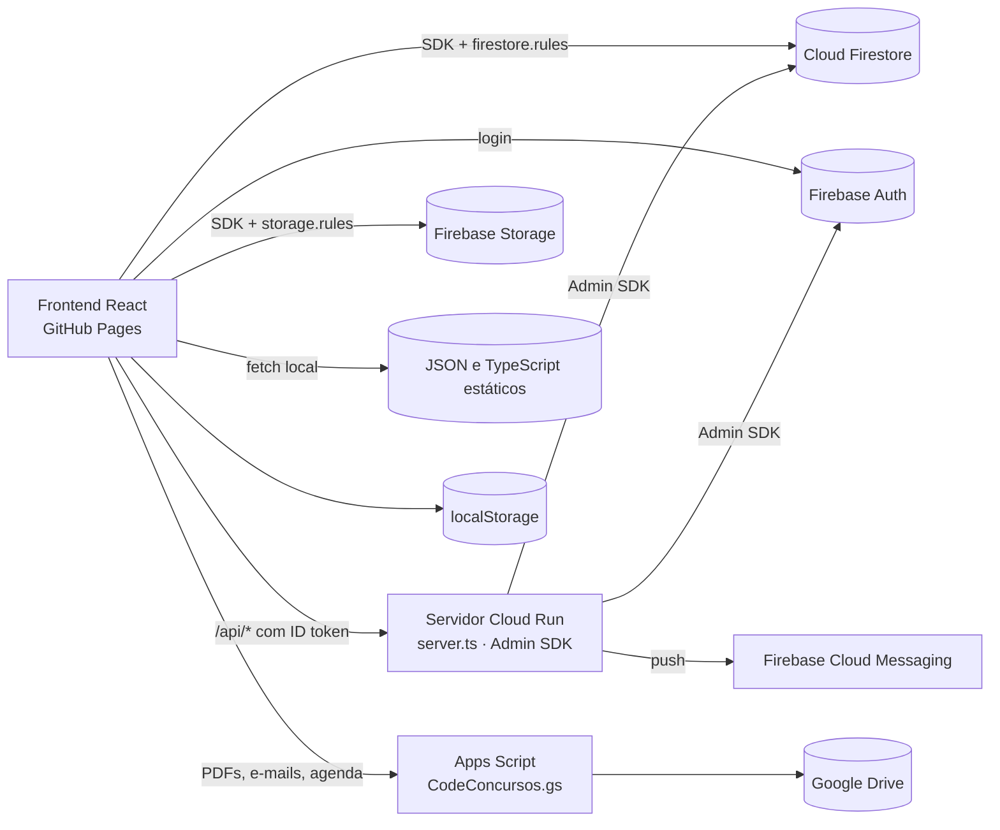

# Banco de Dados

## 1. Visão geral

> **Atualizado em 06/11/2026.** A fonte dos dados operacionais é o **Cloud Firestore** do projeto Firebase `jrs-app-web`. A antiga planilha principal do Google Sheets (abas `ListasRef`, `OM`, `Perito`, `Militares`, `Templates`, `Templates_Documentos`, `Pareceres`, `Pericia_Menor` e `Usuarios`) e a planilha de conteúdos extras **não são mais usadas pelo app**: os dados foram migrados para o Firestore e o código que as lia foi removido do repositório.

A persistência do **Guia Médico Naval — JRS/HNRe** está distribuída entre:

1. **Cloud Firestore** — banco principal: usuários, inspecionados, Inspeções de Saúde e agenda, concursos e candidatos (com exames, triagem e auditoria), pareceres, perícias menores, a escala do SPA, legislação, conteúdos de formação, notificações e a fila de impressão;
2. **Firebase Storage** — PDFs da legislação e das perícias menores, imagens dos infográficos e fotos de perfil. O app não abre esses arquivos direto de `firebasestorage.googleapis.com`: pede os bytes ao servidor do Cloud Run (`/api/arquivos/baixar`, com login), porque redes como a da Marinha bloqueiam ou interceptam o domínio do Storage;
3. **Google Drive** (via Apps Script `CodeConcursos.gs`) — PDFs dos concursos, dos pedidos de parecer e dos exames dos candidatos;
4. **Firebase Authentication** — contas de login (e-mail sintético derivado do usuário; ver `services/firebaseAuth.ts`);
5. **JSON e TypeScript estáticos** — catálogos (`public/*.json`) e conteúdo normativo no bundle;
6. **`localStorage`** — preferências por aparelho (acesso rápido, convite de notificações adiado, aviso de triagem, token do push).

O acesso ao Firestore é feito direto do navegador pelo SDK do Firebase, protegido pelas regras em `firestore.rules` (versionadas no repositório e publicadas no console ou com `firebase deploy --only firestore:rules`). O servidor no Cloud Run (`server.ts`, Firebase Admin SDK) só escreve o que o cliente não pode: notificações, controle de repetição e operações de Admin.

> **Constatação:** o Firestore resolveu boa parte das limitações do modelo em planilha (identificadores únicos, transações no agendamento, leitura em tempo real e regras de acesso por perfil). Continuam sem esquema formal, migrações versionadas ou validação no servidor para a maioria das coleções — a validação é feita nas telas.

---

## 2. Diagrama geral de persistência



---

## 3. Fontes de dados

| Fonte | Tipo | Finalidade | Escrita | Autoridade atual |
|---|---|---|---:|---|
| Cloud Firestore | Banco de documentos | Dados operacionais (seções 4 a 14) | Sim (cliente e servidor) | **Fonte principal** |
| Firebase Storage | Arquivos | PDFs da legislação e perícias menores, infográficos, fotos | Sim | Fonte dos arquivos citados |
| Google Drive | Arquivos (via Apps Script) | PDFs dos concursos, pareceres e exames de candidatos | Sim | Fonte desses PDFs |
| Firebase Authentication | Identidade | Contas de login | Sim (cliente e Admin SDK) | Fonte das contas |
| `public/*.json` | JSON estático | CID, serviços do HNRe, finalidades e restrições das IS, OMs, corpos e quadros | Não em runtime | Fonte local de consulta |
| `constants.ts` e componentes | TypeScript | Conteúdo normativo e de doenças | Não em runtime | Versionado no Git |
| `localStorage` | Navegador | Preferências por aparelho | Sim | Só daquele aparelho |

---

## 4. Pareceres no Firestore (substitui o histórico em planilha)

A página **Pareceres** deixou de usar a planilha/Apps Script principal. Os dados ficam no Firestore:

| Coleção | Documento | Conteúdo |
|---|---|---|
| `pareceres` | id automático, um por pedido | `militarId` (NIP só dígitos = id em `militares`), `inspecionado` (cópia do texto usado no pedido), `especialidade`, `finalidade`, `historico`, `quesitos[]`, `pdfUrl`, `status` (`solicitado` \| `concluido`), `solicitanteUid/Nome/Posto`, `criadoEm`, `concluidoEm`, `concluidoPor` |
| `quesitosParecer` | slug da especialidade (ex.: `psiquiatria`) | `especialidade` (maiúsculas) e `quesitos[]` — modelos sugeridos; edição só do Admin |

Decisões:
- **Coleção na raiz**, e não subcoleção do militar: permite listar/filtrar todos os pedidos (status, especialidade) sem `collectionGroup`, e o pedido (documento histórico) sobrevive à exclusão do cadastro. O vínculo é `militarId`, que a Perícia Menor também poderá usar.
- **Status "atrasado" é derivado**: `solicitado` há 20 dias ou mais (`PRAZO_ATRASO_DIAS` em `services/firestorePareceres.ts`). Nada gravado precisaria de rotina agendada para virar "atrasado".
- **PDF**: gerado pelo servidor do app em HTML + CSS (`/api/documentos/pedido-parecer`, `servidor/documentos/pedidoParecer.ts`; antes, template Google Docs no Apps Script) e guardado no **Google Drive** (pasta `PARECERES`, id `176YQTOO…`, subpasta com o nome completo do inspecionado, arquivo `SOL_PARECER_{especialidade sem acentos}_{DDMMMAAAA}.PDF`) pela ação `salvarPdfParecer`; o `pdfUrl` no Firestore é a URL de visualização (`/view`) do Drive, aberta numa nova janela (desktop e mobile) (pareceres antigos mantêm a URL do Storage `pareceres/{id}.pdf`).
- Carga inicial dos quesitos: `scripts/migrar-quesitos-parecer.mjs` (dados em `scripts/quesitos-parecer.json`).

## 5. Perícias Menores no Firestore

A página **Perícia Menor** (chamada **Atestados** para `user_medicos_mpi` e `user_medicos_geral`) deixou de usar a aba `Pericia_Menor` e a Guia de Encaminhamento (Google Docs). Os dados ficam no Firestore:

| Coleção | Documento | Conteúdo |
|---|---|---|
| `periciasMenores` | id automático (as migradas: `planilha-LINHA`) | `militarId` (NIP só dígitos = id em `militares`), `inspecionado`, `om`, `servico`, `cid`, `dispensas[]`, `dataAtestado` (AAAA-MM-DD), `tempoAtestado`, `tempoHomologado` (tempo que conta para a dispensa), `homologacao` (boolean: *Homologar Atestado* = true, *Registrar Atestado* = false), `medicoEmissor`/`crmEmissor` (só na homologação, lidos da foto), `dataTermino`, `vdf` (boolean; "ENC p/ VDF?" respondido com Sim/Não, obrigatório), `peritoUsuario/Nome/Uid` (médico que registrou), `pdfUrl`, `criadoEm` |

Decisões:
- **`dataTermino`** = `dataAtestado` + `tempoHomologado` − 1 (o dia do atestado conta como o 1º), calculada ao gravar.
- **Status derivado**, não gravado: **Vigente** enquanto hoje ≤ `dataTermino`; depois, **Concluída** (`statusPericia` em `services/firestorePericiasMenores.ts`).
- **PDF do atestado** (foto obrigatória): a foto recortada recebe o filtro "Documento" (`utils/filtroDocumento.ts`) e vira PDF no navegador (`utils/imagemParaPdf.ts`) e vai ao Storage em `periciasMenores/{id}.pdf`. A leitura por IA é feita pelo **Firebase AI Logic** (Gemini 3.5 Flash via Vertex AI, região global, saída por esquema JSON, protegida pelo App Check com reCAPTCHA Enterprise — `services/atestadoIA.ts`, `services/appCheck.ts`). Se a leitura falhar, os campos são preenchidos à mão e a foto é arquivada mesmo assim.
- **Tempo:** `tempoHomologado` é o tempo que conta — o do atestado ao registrar, o homologado ao homologar — e vai até 20 dias; somado às perícias do militar vigentes ou concluídas há até 10 dias, não passa de 30 (`utils/periciaMenorRegras.ts`, validado na tela).
- **Dispensas:** textos da lista fixa de `DispensasModal.tsx` ("TODAS AS ATIVIDADES" é exclusiva). Duas gravam o complemento digitado no próprio texto: `Movimentos repetitivos com sobrecarga {local}` e `Permanecer em pé por mais de {N} horas`. Registros antigos podem ter "LTS", exibido como "Dispensa".
- **Serviço do HNRe** vem de `militares.servico_label` e só é exibido e gravado (`servico`) para militares da OM HNRe; médicos podem gravar só esse campo no cadastro (regra do Firestore).
- Carga do histórico: `scripts/migrar-pericias-menores.mjs` (dados em `scripts/pericias-menores.json`).

### 5.1 Escala SVÇ do SPA no Firestore

| Coleção | Documento | Conteúdo |
|---|---|---|
| `escalaSpa` | data `AAAA-MM-DD` | `data`, `supervisor`, `retemSupervisao`, `dia[]`, `retemDia`, `noite[]`, `retemNoite`, `atualizadoEm` |

- **Origem:** CSV enviado pelo Admin na página *Escala SVÇ* (`components/escala/ImportarEscalaCsv.tsx`, regras em `utils/escalaSpa.ts`). Aceita o modelo `DATA;SERVICO;MEDICOS;RETEM` (uma linha por serviço; `SERVICO` = Supervisão, DIA ou NOITE; nos plantões, dois médicos separados por vírgula) ou o CSV exportado da aba *Agenda* da planilha da escala (colunas Início, SVC, Medico, Retens). Separador detectado sozinho; arquivo em UTF-8 ou Windows-1252.
- **Gravação:** em lotes de 400 com `set(..., { merge: true })` — reenviar só a supervisão de um dia não apaga os plantões daquele dia.
- **Nomes:** gravados como na escala (ex.: `1T (RM2-Md) COSTA`); o cruzamento com o login ignora o parêntese, acentos e caixa (`chaveNome`).
- **Derivados, não gravados:** cor do dia (útil, fim de semana/feriado nacional, de PE ou do Recife, festas maiores) e os serviços do usuário (`servicosDoUsuario`).

## 6. PDFs dos concursos no Google Drive

Os PDFs ligados aos concursos (mensagens, termos de recurso/cientificação, pedidos de parecer e solicitações de exames) **não ficam mais no Firebase Storage**: são gravados no drive compartilhado, pasta raiz `CONCURSOS` (id `1eBTehJDTOPjsgOeP3DjWKbE-iXdIKGos`), pelo Apps Script standalone (`CodeConcursos.gs`) via `services/driveConcursos.ts`:

```
CONCURSOS/
  {ano}/                       ano da criação do concurso
    {nome do concurso}/
      CANDIDATOS/{nome do candidato}/{tipoDocumento}_{matrícula}_{AAAAMMDD-HHMMSS}.pdf
      CANDIDATOS/{nome do candidato}/EXAMES_{NOME_DO_CANDIDATO}.pdf
      MENSAGENS/{timestamp}_{arquivo}.pdf
```

- As pastas são criadas à medida que são necessárias (ano, concurso, CANDIDATOS e MENSAGENS na criação do concurso; a pasta do candidato ao gerar o primeiro documento).
- `tipoDocumento`: `termoRecurso`, `termoCientificacao`, `solicitacaoParecer`, `solicitacaoExames`.
- No Firestore continuam as mesmas URLs (`termoRecursoUrl`, `termoCientificacaoUrl`, `solicitacoesParecer[].url`, `solicitacoesExames[].url`, `mensagens/{id}.fileUrl`), agora do Drive: visualização (`https://drive.google.com/file/d/…/view`), tanto para os documentos do candidato quanto para as mensagens; os botões abrem a URL numa nova janela. URLs antigas do Storage continuam válidas.
- Ao apagar/regerar um termo, o arquivo do Drive vai para a lixeira (só arquivos sob a pasta raiz); URLs antigas do Storage são apagadas do Storage.
- As ações do script que gravam no Drive exigem o `idToken` do Firebase (validado em `exigirUsuarioFirebase`).
- A transcrição e os dados da mensagem (cabeçalho, texto, período, candidatos) são lidos pelo Gemini no próprio app (Firebase AI Logic, `PROMPT_MENSAGEM_CONCURSO` em `config/promptsIA.ts`) e gravados no Firestore como antes. O Apps Script não chama mais o Gemini (a propriedade `GEMINI_API_KEY` do script pode ser apagada).

### Exames entregues pelo candidato

Os exames que o candidato apresenta na IS de Ingresso são enviados em PDF pelo app e seguem a **mesma lógica de pasta** dos termos e das solicitações (pasta do candidato, dentro de `CANDIDATOS`), mas com nome próprio: `EXAMES_{NOME_COMPLETO_SEM_ACENTOS}.pdf` (ex.: `EXAMES_JOSE_DA_SILVA_JUNIOR.pdf`). Um segundo PDF do mesmo candidato ganha sufixo (`_2`, `_3`…) — nada é sobrescrito.

O app faz duas coisas em paralelo (`services/driveConcursos.ts`): a ação `salvarExamesCandidato` do Apps Script grava o PDF no Drive, e o Gemini (Firebase AI Logic, `PROMPT_EXAMES_CANDIDATO`) transcreve os laudos. Se a leitura falhar, o PDF continua salvo e o app grava o link de qualquer forma, com o aviso do erro.

A transcrição estruturada vai para uma subcoleção, um documento por PDF enviado:

| Coleção | Documento | Conteúdo |
|---|---|---|
| `concursos/{id}/candidatos/{matrícula}/exames` | id automático | `pdfUrl`, `nomeArquivo`, `paciente` (`nome`, `dataNascimento`, `cpf`, `identidade`), `exames[]`, `observacoes[]`, `quantidade`, `criadoEm` (ISO), `criadoPorNome` |

Cada item de `exames[]`: `ordem`, `categoria`, `nome`, `paciente`, `emissor`, `conselho`, `data`, `itens[]` (`{ nome, valor }`), `resultado` e `texto`. As categorias e as regras de cópia ficam em `utils/examesCandidato.ts`:

- `hemograma`, `eas`, `bioquimica` — um objeto cada, com um item por analito, **só o valor, sem unidade de medida** (plaquetas em milhares); valores repetidos em laudos de datas diferentes usam o mais recente, e o emissor/data do bloco é o do laudo mais recente. Na tela, cada analito é copiado separadamente e o emissor fecha o bloco.
- `betaHcg`, `vdrl`, `antiHiv` — resultado e emissor são copiados **juntos**; no anti-HIV o método entra no nome.
- `imagem`, `colpocitologia`, `ecg`, `toxicologico` e `outro` — laudo integral em `texto` (sem cabeçalho/rodapé da clínica). O texto copiado começa por `# NOME DO EXAME` e uma linha em branco, e termina com o emissor; o `#` fica só no texto copiado, não no título do card.

No documento do candidato ficam só o resumo que a tabela usa (`examesQtd`, `examesPdfUrls[]`, `examesEnviadoEm`) — a transcrição inteira não é lida ao listar os candidatos. `examesQtd` é o badge do botão de exames na coluna *Ações*, que abre a tela cheia com os blocos. **Limpar IS** (Admin) apaga a subcoleção e manda os PDFs para a lixeira do Drive.

Regras do Firestore: `concursos/{id}/candidatos/{matrícula}/exames/{id}` — leitura para qualquer usuário autenticado; criação por quem tem a funcionalidade `concursosJRS.enviarExamesCandidato`; edição e exclusão só do Admin.

---

## 7. Legislação no Firestore + PDFs no Storage

A página **Legislação** lê a coleção `legislacao` (migrada da aba `NORMAS` da planilha `17Dl5d3C…`) e abre o PDF de cada norma, do Firebase Storage, num modal em tela cheia.

| Campo | Descrição |
| --- | --- |
| id do documento | slug da norma (ex.: `lei-6880-1980`) |
| `ordem` | posição na lista |
| `legislacao` | identificação curta (ex.: `LEI nº 6.880/1980`) |
| `titulo` | título amigável |
| `providencias` | ementa (botão ⓘ) |
| `imageUrl` | brasão/logotipo exibido no card |
| `pdfPath` | caminho no Storage (`legislacao/{id}.pdf`) ou `null` se ainda não enviado |

Regras: Firestore — leitura autenticada, escrita só Admin; Storage (`legislacao/*`) — leitura autenticada, escrita só do Admin (perfil lido do Firestore), PDF até 25 MB. O botão **Novo** da página (só Admin) abre uma sidebar que envia o PDF para `legislacao/{id}.pdf` e cria o documento (id = slug da identificação).

---

## 8. Usuários, inspecionados e permissões no Firestore

| Coleção | Documento | Conteúdo |
|---|---|---|
| `usuarios` | UID do Firebase Auth | `usuario` (login, ex.: `CT MAURISTON`), `nome`, `postoGraduacao`, `cargo`, `nip`, `crmPe`, `rqe`, `email`, `gmail`, `celular`, `perfil` (`admin` \| `user_medicos` \| `user_medicos_mpi` \| `user_secretaria` \| `user_medicos_geral`), `ativo`, `imageProfile`, `senhaTemporaria`, `pwaTutorialConcluido` |
| `usuarios_publicos` | UID | Réplica mínima (`usuario`, `ativo`) para o menu de login, legível sem autenticação |
| `config/permissoes` | documento único | Matriz de páginas e funcionalidades por perfil (editada pelo Admin em *Usuários*) |
| `militares` | NIP só dígitos | Inspecionados (página *Inspecionados*): `tipo` (militar, dependente ou pensionista; dependente traz `titularId/Nome/Posto`), `om`, `temporario`, `pgq`, `nip`, `nome`, `inspecionado` (`{pgq} {nip} {nome}`), `email`, `ativo`, `rm1`, `refo`, `servico_label` (só HNRe), `nomeGuerra` e `especialidade` (oficiais médicos do HNRe) |

- O próprio usuário só altera e-mail, Gmail, celular, foto, `senhaTemporaria` e `pwaTutorialConcluido`. Perfil, nome, NIP e cargo só o Admin altera.
- **E-mails:** `email` (institucional) só aceita `@marinha.mil.br`; qualquer outro domínio vai em `gmail` (`utils/emails.ts`, validado no Perfil e em Usuários).
- **Contas em lote:** `scripts/criar-usuarios-csv.mjs` cria contas no Auth e em `usuarios`/`usuarios_publicos` a partir de um CSV (senha inicial com `senhaTemporaria = true`); usado para as contas `user_medicos_geral`.
- **Inspecionados em lote:** o Admin importa um CSV (`nip | vinculo | posto | nomeCompleto | om | nasc`) na página *Inspecionados*; só os NIPs ainda não cadastrados são gravados (`criarMilitaresEmLote`). O cadastro unitário pode vir de um print do SINAIS lido pela IA (`utils/inspecionadoSinais.ts`); a imagem não é guardada.
- **Excluir usuário** (Admin, só usuários **inativos**): o servidor (`/api/admin/excluir-usuario`) apaga a conta no Auth e os documentos em `usuarios` e `usuarios_publicos`. **Redefinir senha** (`/api/admin/resetar-senha`) volta à senha inicial e marca `senhaTemporaria`.

## 9. Inspeções de Saúde e agenda dos peritos

| Coleção | Documento | Conteúdo |
|---|---|---|
| `inspecoes` | nº da IS (só dígitos) — garante número único | `is`, `dataAbertura` (AAAA-MM-DD), `dataEntrevista` (AAAA-MM-DDThh:mm ou vazio), `finalidade`, `grupoFinalidade`, `amp` (`JRS` \| `MPI`), `peritoUid/Nome/Gmail`, `inspecionadoId` (NIP = id em `militares`), `inspecionado` (texto copiado), `situacao`, `status`, `dataLaudo`, `laudo`, `observacoes`, `restricoes`, `tis` (`AAA.000.N…`), `ds1a`, `minutaCancelamento?`, `eventoAgendaId?`, `agendaSincronizada?`, `emailResultadoPara?`, `emailResultadoEnviadoEm?`, `emailResultadoEnviadoPor?` (e-mail do resultado ao inspecionado, gravados só pelo servidor — `servidor/email/resultadoIS.ts`; envio único), `emailAgendamentoPara?`, `emailAgendamentoDataEntrevista?`, `emailAgendamentoEnviadoEm?` (e-mail de agendamento; um por data/hora da entrevista), `emailFaltaDataEntrevista?`, `emailFaltaEnviadoEm?` (comunicação de falta do HNRe; uma nova falta em outra data volta a ficar pendente), `emailNacEnviadoEm?`, `emailNacEnviadoPor?` (envio ao NAC) — todos gravados só pelo servidor, `criadoPor`, `criadoEm`, `atualizadoEm` |
| `agendaSlots` | `{peritoUid}__{AAAA-MM-DD}T{hh-mm}` | Um documento por horário ocupado. É gravado na **mesma transação** do agendamento, que reserva o slot novo e libera o anterior, então dois usuários nunca ocupam o mesmo horário do mesmo perito |
| `bloqueiosAgenda` | id automático | `data`, `dataFim?` (bloqueio de período, dia inteiro), `turno` (`manha` \| `tarde` \| `dia`), `hora?`, `peritoUid` (`*` = todos), `peritoNome?`, `motivo`, `eventoAgendaId?`, `afastamentoId?` (bloqueio criado pela página Férias) |
| `afastamentos` | id automático | Férias e afastamentos dos usuários da JRS (página Férias; `services/afastamentos.ts`): `usuarioUid`, `usuario` (login), `perfil`, `tipo` (`ferias` \| `lts` \| `lic_adm`), `dataInicio`, `duracaoDias`, `dataFim` (calculada), `status` gravado (`programada` \| `confirmada` \| `em_gozo` \| `gozada`; o exibido é recalculado pela data — `utils/afastamentos.ts`), `referencia?`, `motivo?`, `arquivos[]` (`nome`, `caminho` no Storage `afastamentos/{id}/`, `tipo`, `tamanho`), `bloqueioId?` (médicos), `eventoAgendaId?`, `agendaSincronizada`, `criadoPor`, `criadoEm`, `atualizadoEm` |
| `emailsAgendaIS` | data da agenda (AAAA-MM-DD) | Registro do e-mail **"IS AGENDADAS EM dd/mm/aaaa"** (`servidor/email/agendaIS.ts`), gravado só pelo servidor: `data`, `pdfCaminho` (Storage), `para[]`, `cc[]`, `totalIS`, `totalConcursos`, `envios` (contador), `ultimoEnvioEm`, `ultimoEnvioPor` (uid ou `agendador`), `envioAutomaticoEm?` (o automático das 18h sai uma vez por data). O Admin lê no modal de envio |
| `config/emails` | documento único | Configuração dos e-mails automáticos (página *Configurações*, só o Admin grava; o servidor lê a cada envio — `servidor/email/comum.ts`): `responderPara`, `assinatura {presidenteNome, presidentePosto, supervisorNome, supervisorPosto, supervisorCargo}`, `saudacaoFaltasHNRe`, `saudacaoNac`, `testes {para[], cc[]}` (destinatários dos e-mails de teste), `destinatarios {resultadoIS, agendaIS, agendamentoIS, faltasHNRe, inaptosConcurso, nac}: {para[], cc[], cco[]}`, `atualizadoEm`, `atualizadoPor`. Campo ausente = padrão de `config/emails.ts`. Alteração registrada em `auditoria_acoes` (`config.alterar`) |
| `config/agendaIS` | documento único | Turnos em que cada perito atende, por dia da semana (só o Admin grava) |
| `inspecoes/{isId}/entrevistas` | id gerado pelo app | **Entrevista gravada da IS** (ADR-014; contrato em `config/entrevistas.ts`). O app cria com `isId`, `participantes` (2 a 4: `nome`, `papel` = perito \| inspecionado \| membro_junta \| acompanhante \| outro), `finalidade`, `consentimento` e `criadoPor` (`{uid, nome, em}`) e `situacao` = `aguardando_envio`. O **servidor** grava `situacao` (`transcrevendo` → `organizando` → `pronta` \| `erro`), `erro?`, `audio` (`caminho`, `mimeType`, `bytes`, `duracaoSeg`, `apagarApos` AAAA-MM-DD), `operacaoSpeech`, `transcricao` (`[{falante: "F1", inicioSeg, fimSeg, texto}]`), `mapaFalantes` sugerido, `anamnese` (resumo executivo, queixa principal, alegações, história cronológica `{quando, evento, fonte, tempoSeg?}`, antecedentes, medicações, tratamentos, exames citados, repercussão funcional, `secaoFinalidade {titulo, texto}`, pontos a esclarecer, citações `{falante, texto, tempoSeg}`), `modelos`, `atualizadoEm`. Depois de criado, o app só altera `mapaFalantes`, `falantesConfirmados`, `anamneseEditada` (a original da IA fica em `anamnese`), `editadoPor` e `revisada` |

- **Status derivados**, não gravados: IS **Atrasada** (aberta sem entrevista há mais de 7 dias; 60 dias no grupo *Benefícios*).
- **Férias** da Início: afastamentos do tipo Férias em gozo ou gozados (coleção `afastamentos`).
- Os **dias de concurso** não são gravados como bloqueio: são derivados dos candidatos (seção 10) e ocupam o turno da manhã de todos os peritos.
- **PDF da agenda de IS** no Storage em `agendaIS/{ano}/IS_AGENDADAS_{AAAA-MM-DD}.pdf`: anexo do e-mail das IS agendadas, **um arquivo por data** — o reenvio grava no mesmo caminho e substitui o anterior, sem duplicar. Só o servidor grava e lê (`storage.rules` não libera a pasta ao app).
- **Áudio das entrevistas** no Storage em `entrevistas/{isId}/{entrevistaId}/` (`original.{ext}` enviado pelo celular e `audio.flac` convertido pelo servidor). `storage.rules`: só a junta (Admin e `user_medicos`) envia o `original.*` (áudio até 80 MB); ninguém lê, troca nem apaga pelo app — o áudio é ouvido por `/api/entrevistas/ouvir`. Apagado **90 dias** depois pela regra de ciclo de vida do bucket (`scripts/entrevistas/configurar-retencao.sh`; ainda recuperável na lixeira por 30 dias). Nenhum PDF é gerado.

## 10. Concursos e candidatos

| Coleção | Documento | Conteúdo |
|---|---|---|
| `concursos` | slug do concurso (ex.: `CPAEAM-2026`) | `nome`, `status` (`em_breve` \| `em_andamento` \| `encerrado`; só o Admin altera), `dataHoraMensagemInicial`, `assuntoMensagemInicial`, `periodoInicioISO`, `periodoFimISO`, `totalCandidatos`, `criadoEm` |
| `concursos/{id}/candidatos` | matrícula | `nome`, `dataAgendamento` (AAAA-MM-DD), `status` (vazio, `Pendente`, `APTO`, `INAPTO`, `FALTOU`, `INSUF DOCUMENTAL`, `Reagendado`), `observacoes`, `numTIS`, `finalizado`, `dataLaudo`, `laudo`, `recurso`, `termoRecursoUrl`, `termoCientificacaoUrl`, `solicitacoesParecer[]` e `solicitacoesExames[]` (`{ url, rotulo, criadoEm }`), `examesQtd`, `examesPdfUrls[]`, `examesEnviadoEm`, **`triagem`** (abaixo) |
| `…/candidatos/{matrícula}/exames` | id automático | Transcrição dos exames entregues (ver seção 6) |
| `…/candidatos/{matrícula}/eventos` | id automático | Auditoria da IS: `acao`, `detalhe`, `uid`, `usuario`, `nome`, `em`. Qualquer usuário grava em seu nome; só o Admin lê; ninguém edita nem apaga |
| `concursos/{id}/mensagens` | id automático | Mensagens administrativas arquivadas (`dataHora`, `fileUrl`, `proposito`, `sender`, `recipient`, `info`, `subject`, `texto`) |
| `concursos/{id}/agendamentos` | AAAA-MM-DD | Datas do calendário de agendamento (`diaSemana`) |

**Finalização:** `finalizado` vira `true` quando a IS tem status com laudo, Nº TIS e, para INAPTO ou INSUF DOCUMENTAL, Observações (`candidatoEstaFinalizado` em `utils/concursosUtils.ts`). A IS finalizada não aceita mais edição pelo app.

**IS atrasada** (derivada, não gravada): `dataAgendamento` anterior a hoje e `finalizado == false`, nos concursos Em andamento ou Em breve. Alimenta o item da Início e a página `/concursos/atrasadas`.

**Triagem** (`candidatos/{matrícula}.triagem`, gravada pelo `user_medicos_mpi`):

| Campo | Formato |
|---|---|
| `altura` | texto `d,dd` (m), ex.: `1,75` |
| `peso`, `pas`, `pad`, `fc` | 2 ou 3 dígitos (kg, mmHg, mmHg, bpm) |
| `snellenSC`, `snellenCC` | só o denominador do Snellen (`20/xxx`), 2 ou 3 dígitos; `snellenCC` pode ser vazio |
| `ishiharaErros` | 0 a 15 (placas fixas em 15) |
| `entrevista`, `exameClinico`, `exames` | `{ alterado: boolean, texto: string }` |
| `atualizadoEm`, `atualizadoPor` | ISO e login de quem salvou |

- O IMC **não é gravado**: é calculado de `peso` e `altura`. Os alertas de possível inaptidão também são calculados (`utils/triagem.ts`).
- Salvar a triagem registra o evento "Triagem registrada/alterada" na auditoria. **Limpar IS** (Admin) apaga a triagem (`deleteField`), além de status, laudo, documentos e exames.

- **E-mail de inaptos à EAMPE:** o servidor grava no candidato `emailInaptoEnviadoEm` e `emailInaptoEnviadoPor` (`servidor/email/inaptosConcurso.ts`); INAPTO sem esses campos = pendente. São gravados só pelo Admin SDK (as regras por campo do app não os alteram); uma regravação completa do candidato sem *merge* (ex.: script de sobrescrever candidatos) apagaria a marca e o candidato voltaria a pendente.

## 11. Formação: vídeos, infográficos, apresentações e casos periciais

| Coleção | Documento | Conteúdo |
|---|---|---|
| `videos` | id do vídeo no YouTube | `youtubeId`, `titulo` (oEmbed do YouTube), `thumbnailUrl`, `criadoPor`, `criadoEm` |
| `infograficos` | id automático | `titulo`, `imagePath` (Storage `infograficos/{id}.{ext}`), `imageUrl`, `criadoPor`, `criadoEm` |
| `apresentacoes` | id automático | `url`, `plataforma` (Google Slides, Canva, GitHub Pages), `titulo` e `thumbnailUrl` (lidos pelo servidor em `/api/admin/preview-apresentacao`), `criadoPor`, `criadoEm` |
| `visualizacoesExtras` | `{tipo}__{itemId}__{uid}` | Quem abriu cada item e quantas vezes (`vezes`, `ultimaEm`, `nome`). Cada usuário grava só o próprio registro; só o Admin lê |
| `casos_periciais_resultados` | UID | Último resultado do teste *Casos Periciais* (`respostas[]`, `acertos`, `total`, `nota`); cada usuário lê e grava só o próprio |

Vídeos e infográficos vinham de uma planilha de extras, que deixou de ser usada; o cadastro agora é pelo Admin, na própria página.

## 12. Notificações push

| Coleção | Documento | Conteúdo |
|---|---|---|
| `tokens_push` | token do FCM (um por aparelho/navegador) | `uid`, `usuario`, `plataforma` (user agent), `atualizadoEm`. O dono grava e apaga; ninguém lê pelo app. Apagado no logout |
| `usuarios/{uid}/notificacoes` | id do envio (o mesmo para todos os destinatários) | `titulo` (tipo do aviso), `corpo`, `rota` (tela do app aberta ao tocar), `lida`, `em`. Só o servidor cria; o dono lê e só altera `lida` |
| `notificacoes_enviadas` | chave do evento (ex.: `inapto_{concurso}_{matrícula}_{data}`, `dia_{concurso}_{data}`, `login_{uid}`) | Controle de repetição. Só o servidor lê e grava |

O cliente só avisa o servidor (`/api/notificacoes/evento`); o servidor confere o evento no Firestore, grava o histórico de cada destinatário e envia o push. O link do push traz `?notif={id}`, e o app marca a notificação como lida ao abrir.

## 13. Fila de impressão da Secretaria

| Coleção | Documento | Conteúdo |
|---|---|---|
| `documentos_gerados` | id automático | `tipo` (`termo-recurso`, `termo-cientificacao`, `solicitacao-parecer`, `solicitacao-exames`, `pedido-parecer`), `titulo`, `detalhe` (candidato/inspecionado e concurso), `pdfUrl`, `remetente`, `criadoPorUid`, `criadoEm`, `aberto`, `abertoEm`, `abertoPor` |

- Registrado ao gerar ou enviar para impressão os documentos com automação de e-mail e o Termo de Cientificação de Resultado (best-effort).
- A Início da Secretaria lista os não abertos (`where('aberto', '==', false)`, ordenados no cliente, sem índice composto). Abrir o PDF marca `aberto = true`.
- Regras: qualquer usuário cria em seu nome, sempre com `aberto == false`; Secretaria e Admin leem e só alteram `aberto/abertoEm/abertoPor`; só o Admin apaga.

## 14. Resumo das regras de acesso (`firestore.rules`)

| Coleção | Leitura | Escrita |
|---|---|---|
| `usuarios` | autenticado | Admin; o próprio usuário só os campos de contato, foto e flags |
| `usuarios_publicos` | pública | Admin ou o próprio usuário |
| `usuarios/{uid}/notificacoes` | o dono | servidor cria; o dono só marca `lida` |
| `tokens_push` | ninguém | o dono (`uid` = usuário logado) |
| `notificacoes_enviadas` | ninguém | ninguém (só o servidor) |
| `segredos_servidor` | ninguém | ninguém (só o servidor: *refresh token* da conta Google da JRS — ADR-013) |
| `documentos_gerados` | Secretaria e Admin | criar: autenticado em seu nome; marcar aberto: Secretaria e Admin; apagar: Admin |
| `militares` | autenticado | criar: equipe; editar: Admin (médicos só `servico_label`); apagar: Admin. O servidor grava `email` quando o e-mail do resultado da IS é enviado a quem não tinha e-mail no cadastro |
| `emailsAgendaIS` | Admin | ninguém (só o servidor) |
| `inspecoes`, `agendaSlots` | autenticado | equipe (Admin, médicos, Secretaria); apagar IS: Admin |
| `inspecoes/{isId}/entrevistas` | junta (Admin e `user_medicos`), qualquer IS | criar: junta, em seu nome, só os campos de criação, situação `aguardando_envio`, 2 a 4 participantes; editar: junta, só `mapaFalantes`, `falantesConfirmados`, `anamneseEditada`, `editadoPor`, `revisada` (transcrição, anamnese da IA, áudio e situação são do servidor); apagar: Admin |
| `afastamentos` | equipe (Admin, médicos, MPI, Secretaria) | só Admin (arquivos em Storage `afastamentos/`: equipe lê, Admin envia e apaga) |
| `bloqueiosAgenda` | autenticado | Admin e Secretaria; médico só os próprios |
| `pareceres` | autenticado | médicos criam; não-Admin só altera o status de conclusão |
| `escalaSpa` | autenticado | só Admin grava |
| `periciasMenores` | autenticado | médicos criam; Admin edita e apaga |
| `concursos` e subcoleções | autenticado | por funcionalidade da matriz `config/permissoes` e por campo (abaixo); exclusão só Admin; eventos só criação, leitura do Admin |
| `legislacao`, `videos`, `infograficos`, `apresentacoes`, `quesitosParecer`, `config` | autenticado | Admin |
| `visualizacoesExtras` | Admin | o próprio registro |
| `casos_periciais_resultados` | o dono | o dono |

### Concursos: regras por funcionalidade e por campo

As regras leem a **mesma matriz** da tela (`config/permissoes`, `features[id][perfil]`), com os padrões de `DEFAULT_FEATURE_PERMISSIONS` (`config/permissions.ts`) quando o Admin não alterou a célula — **ao mudar um padrão no código, mude também em `firestore.rules`**. O Admin pode tudo. Cada atualização de candidato só pode mexer nos campos de uma ação:

| Ação (função em `services/firestoreConcursos.ts`) | Funcionalidade | Campos |
|---|---|---|
| Editar Status/Observações/Nº TIS (`atualizarCandidato`) | `editarDadosTabela` | `status`, `observacoes`, `numTIS`, `dataLaudo`, `laudo`, `finalizado`, termos e `recurso` |
| Reagendar (`reagendarCandidato`) | `reagendar` | `dataAgendamento` (obrigatória) e status `Reagendado`, mais o que ele limpa |
| Confirmar agendamento (`confirmarAgendamento`) | `registrarMensagemPDF` ou `reagendar` | só `dataAgendamento` |
| Termo de Recurso (`salvarTermoRecurso`) | `gerarTermoRecurso` | `recurso`, `termoRecursoUrl` |
| Termo de Cientificação (`salvarTermoCientificacao`) | equipe (qualquer perfil) | `termoCientificacaoUrl` |
| Pedido de Parecer / Exames (`registrarSolicitacao`) | `solicitarParecerExames` | novo item em `solicitacoesParecer`/`solicitacoesExames` e status `Pendente` |
| Exames do candidato (`salvarExamesCandidato`) | `enviarExamesCandidato` | `examesQtd`, `examesPdfUrls`, `examesEnviadoEm` (e criar em `exames`) |
| Triagem (`salvarTriagem`) | perfil `user_medicos_mpi` | `triagem` |

Criar concurso: `registrarMensagemPDF` ou `importarCsv`; status e período do concurso: `abrirEncerrarConcurso`; criar candidato: `adicionarCandidato`, `registrarMensagemPDF` ou `importarCsv`; mensagens: `registrarMensagemPDF`, `registrarMensagemArquivo` ou `importarCsv`.

**Publicação:** `.github/workflows/deploy-firestore-rules.yml` roda os casos de `scripts/testar-regras-firestore.cjs` (simulador da API Firebase Rules) e, se passarem, publica `firestore.rules` e `storage.rules` a cada mudança na `main`.
## 15. Arquivos JSON estáticos

### 15.1 `public/cid.json`

Arquivo de grande volume disponibilizado diretamente com o frontend. É usado como catálogo de códigos CID.

Características:

- carregado pelo navegador;
- versionado com o repositório;
- não depende do Google Apps Script;
- atualizado apenas mediante alteração, commit e novo deploy;
- aumenta o volume transferido ao cliente quando carregado integralmente.

### 15.2 `public/servicosHNRe.json`

Catálogo de serviços do Hospital Naval de Recife utilizado no formulário de perícia menor.

Características equivalentes:

- fonte estática;
- sem edição administrativa em runtime;
- sem versionamento semântico do conteúdo;
- potencial divergência em relação ao cadastro do Firestore (`militares.servico_label`).

### 15.3 Recomendações

- documentar a origem e a data de atualização;
- acrescentar um campo de versão no arquivo;
- validar o JSON no pipeline de CI;
- gerar índices simplificados para busca;
- considerar carregamento sob demanda para catálogos volumosos;
- definir uma única fonte de verdade para serviços e especialidades.

Exemplo de envelope versionado:

```json
{
  "schemaVersion": 1,
  "updatedAt": "2026-07-26",
  "source": "fonte oficial",
  "items": []
}
```

---

## 16. Dados estáticos em TypeScript

Parte significativa do conteúdo normativo e médico-pericial está codificada em:

- `constants.ts`;
- componentes de guia;
- componentes de artigos;
- páginas de resumo da DGPM;
- componentes especializados de doenças.

Esses dados são persistidos no Git, não em banco operacional.

### Vantagens

- versionamento por commit;
- funcionamento sem chamada ao backend;
- implantação simples;
- revisão por *pull request*.

### Limitações

- conteúdo e apresentação ficam acoplados;
- alterações editoriais exigem desenvolvimento e novo deploy;
- duplicação e inconsistência são difíceis de detectar;
- não há busca central ou gestão de versões do conteúdo;
- não há metadados editoriais padronizados.

### Evolução sugerida

Migrar progressivamente o conteúdo para Markdown ou JSON estruturado no próprio repositório:

```text
content/
├── doencas/
├── legislacao/
├── artigos/
├── resumos-dgpm/
└── manifest.json
```

Isso mantém o versionamento Git sem misturar conteúdo e componentes React.

---

## 17. Segurança e privacidade dos dados

O sistema trata informações pessoais e sensíveis: nome e NIP de militares, dependentes e pensionistas; OM e situação funcional; dados de saúde (CID, laudos, triagem, exames); atestados em imagem; pareceres e documentos médico-periciais; dados de usuários.

> **Aviso:** a revisão formal de conformidade com a LGPD e as normas internas é **humana** (Encarregada de Dados/Comando) e **ainda não foi feita**. Esta seção registra apenas controles técnicos. Legenda: **Implementado (31/10/2026)** · **Parcial** · **Pendente**.

### 17.1 Riscos e situação

| Risco | Situação | Observação |
|---|---|---|
| Links do Drive guardados diretamente nos documentos | **Implementado (31/10/2026)**, parcial | Pareceres, perícias menores e `documentos_gerados` gravam também `pdfFileId` (`camposIdDrive` em `utils/googleDrive.ts`). Registros antigos não foram migrados (sem backfill); as telas ainda leem `pdfUrl`. Concursos já guardam `fileId` em parte do fluxo. |
| Dados médicos enviados ao Gemini | **Parcial** | Ver 17.2. A imagem/PDF é o dado necessário e continua sendo enviada; a política do provedor e a base legal dependem da Encarregada. |
| Auditoria de escrita só nas IS de concurso | **Implementado (31/10/2026)**, ampliada | `auditoria_acoes` (exclusão de militar, exclusão de IS, geração de documentos). **Sem auditoria de leitura** (pendente). |
| Dados sensíveis em logs | **Implementado (31/10/2026)** | Ver 17.2. |
| Pastas do Drive com acesso amplo | **Parcial** | Código sem `setSharing`/links públicos (verificado). Revisão real das pastas é manual: checklist em `docs/retencao-lgpd.md`. |
| Retenção/descarte | **Pendente** | Proposta de prazos em `docs/retencao-lgpd.md`, a validar pela Encarregada/Comando. Sem rotina nem campo ativos. |

### 17.2 Controles

- **Minimização dos dados enviados à IA — Implementado (31/10/2026), parcial.**
  - `server.ts` (`/api/gemini/analyze-image` e `/api/concursos/ocr-pdf`): valida o base64 e o tamanho (`base64ValidoParaIA`, teto ~16 MB) e higieniza/trunca o texto livre do cliente (`higienizarParaIA`: remove NIP, CPF, e-mail e telefone; máx. 2000 caracteres); a mensagem de erro devolvida ao cliente é mascarada.
  - Apps Script: o prompt dos exames do candidato deixou de pedir CPF e identidade (`cpf` e `identidade` voltam sempre vazios); o campo continua no esquema por compatibilidade.
  - Mantido por necessidade da finalidade: o atestado (nome do militar, data, dias, CID) e as imagens das IS na geração de minutas (nome, NIP, laudo). Reduzir isso exigiria recortar a imagem no cliente — pendente.
- **Sem dados sensíveis em logs — Implementado (31/10/2026).** `utils/logSeguro.ts` (`logErroSeguro`, `descreverErro`, `mascararSensivel`) registra só contexto, código e mensagem mascarada/truncada (sem corpo, stack ou objeto do erro; mascara NIP, CPF, e-mail, tokens e blocos longos). Todo `console.error` de `server.ts` o usa; no Apps Script, `logSeguro_` (`CodeConcursos.gs`) é usado em `apiResponder`, `doPostPrincipal` e na extração de exames. Pendente: logs do lado do cliente (`console.error` nos `services/` ainda recebem o objeto do erro do Firebase) e logs do próprio Cloud Run/Stackdriver fora do nosso código.
- **Auditoria de escrita — Implementado (31/10/2026).** `services/auditoriaAcoes.ts` grava `auditoria_acoes/{autoId} { acao, alvo, uid, usuario, em }` (best-effort; criar = qualquer autenticado em seu nome; ler = só Admin; imutável — `firestore.rules`). `alvo` é um rótulo fixo (ex.: `militares`, tipo do documento), nunca nome/NIP/CID/URL. Cobre `militar.excluir`, `inspecao.excluir` e `documento.gerar`. Pendente: demais exclusões (vídeos, quesitos, legislação), tela de consulta para o Admin e auditoria de leitura. **Atenção:** as regras novas só valem após o deploy de `firestore.rules`.
- **Menor privilégio no Drive — Parcial.** Verificado no código: nenhum `setSharing`, `addViewer`/`addEditor` ou permissão pública. O web app é `ANYONE_ANONYMOUS` (necessário ao front), protegido pelo `idToken` do Firebase por ação. A conferência do compartilhamento real das pastas é manual (checklist em `docs/retencao-lgpd.md`) — **pendente**.
- **Retenção e descarte — Pendente.** `docs/retencao-lgpd.md` (prazos propostos "a validar pela Encarregada/Comando"). Não há rotina automática nem campo `descarteEm` em uso.
- **Revisão de conformidade com a LGPD e normas internas — Pendente (humana).**

---

## 18. Backup, retenção e recuperação

> **Atualizado em 06/11/2026.** Plano mínimo implementado: backups gerenciados do Firestore, lixeira no Storage e no Drive, inventário de configuração e teste de restauração automatizado.

### 18.1 Firestore — backups agendados

Em vez da exportação manual (`gcloud firestore export` para um bucket), o projeto usa os **backups agendados gerenciados do Firestore** (mesma região do banco, sem bucket nem job próprio para manter):

| Agendamento | Retenção | Situação |
|---|---|---|
| Semanal (segunda-feira) | 14 semanas | **Ativo desde 28/09/2026** (6 backups prontos em 06/11/2026, de 29/09 a 02/11) |
| Diário | 7 dias | **Ativo desde 06/11/2026** (`scripts/backup/configurar-backup.sh`) |

O mesmo script liga a **proteção contra exclusão** do banco `(default)` (`delete protection` — **ativa desde 06/11/2026**) e, com `PITR=1`, a recuperação a qualquer instante dos últimos 7 dias (tem custo; desligada por padrão). O script é idempotente: pode ser rodado de novo sem duplicar agendamentos.

**Vigilância:** o workflow `.github/workflows/backup-firestore.yml` roda toda terça e **falha** (o GitHub avisa por e-mail) se o backup pronto mais recente tiver mais de 8 dias.

### 18.2 Storage e Drive — sem exclusão definitiva automática

- **Storage — exceção:** o áudio das entrevistas gravadas (`entrevistas/`) é apagado **automaticamente 90 dias** após a gravação (regra de ciclo de vida, `scripts/entrevistas/configurar-retencao.sh`; ADR-014). Depois disso, só a lixeira (30 dias) o recupera.
- **Storage:** o app só apaga arquivos por ação de uma pessoa (Admin removendo um infográfico; termo antigo de concurso regerado). O bucket tem **lixeira (soft delete)**: o padrão do Google Cloud era 7 dias; desde 06/11/2026 são **30 dias** (`configurar-backup.sh`) — um arquivo apagado pode ser restaurado nesse prazo (Console → Cloud Storage → bucket → *Objetos excluídos*).
- **Drive:** o Apps Script nunca apaga de vez: cópias temporárias e termos substituídos vão para a **lixeira** (`setTrashed(true)`), recuperáveis por 30 dias. Os PDFs gerados (termos, pareceres, exames, minutas) ficam nas pastas do drive compartilhado, que são o próprio arquivo de longo prazo.
- **Retenção administrativa e descarte:** prazos propostos em `docs/retencao-lgpd.md`, ainda a validar pela Encarregada/Comando (seção 17).

### 18.3 Configuração fora do código e inventariada

- Inventário completo em **`docs/configuracao.md`**: projeto e serviços do Google Cloud, variáveis do Cloud Run, secrets e variáveis do GitHub, propriedades do Apps Script, IDs de pastas, templates e agenda.
- **Apps Script:** os IDs de templates, pastas, agenda e o e-mail da impressão passaram a ser lidos das **Propriedades do script** (`cfg_` em `CodeConcursos.gs`; `ID_PASTA_MINUTAS` em `CodePrincipal.gs`), com o valor atual como padrão — trocar uma pasta não exige editar nem republicar o código. `gravarConfiguracaoPadrao()` (rodar uma vez no editor) grava os padrões nas propriedades. Versão `2026-11-06.5`.
- **Segredos** (chaves de service account, `GEMINI_API_KEY` do servidor) ficam só nos secrets do GitHub e no Cloud Run; o inventário guarda apenas o nome.

### 18.4 Teste de restauração

- `scripts/backup/testar-restauracao.sh` restaura o backup mais recente num **banco temporário** (`restauracao-teste`, mesmo projeto), compara a contagem de documentos das coleções principais com a produção (`scripts/backup/comparar-contagens.mjs`) e apaga o banco temporário — a produção não é tocada.
- Critério: reprova se uma coleção essencial (`usuarios`, `militares`, `concursos`) que tem dados vier vazia; coleções criadas depois do snapshot e diferenças de contagem viram aviso.
- **Agenda:** trimestral (1º de janeiro, abril, julho e outubro), pelo workflow *Backup do Firestore*, ou manual (*Actions → Backup do Firestore → Run workflow → restauracao*).
- Credencial: secret `BACKUP_SA_KEY` (ou `GCP_SA_KEY`) com o papel *Cloud Datastore Owner*.
- **Primeiro teste completo — 06/11/2026: APROVADO.** Backup de 02/11/2026 (05:34 UTC) restaurado em `restauracao-teste` em ~11 minutos; banco temporário apagado em seguida. Contagens (produção → restaurado): `usuarios` 38 → 10, `militares` 433 → 260, `concursos` 16 → 15, `periciasMenores` 12 → 6, `documentos_gerados` 25 → 1 (diferenças = registros criados depois do snapshot, como as 30 contas de médicos gerais e a importação de inspecionados); `inspecoes`, `bloqueiosAgenda`, `pareceres`, `legislacao`, `videos`, `apresentacoes` e `quesitosParecer` idênticas; `escalaSpa` vazia no backup (coleção criada em 06/11, depois do snapshot).
- Para o teste trimestral automático, a credencial do workflow precisa do papel *Cloud Datastore Owner*.

### 18.5 Como recuperar

| Situação | Como |
|---|---|
| Documento ou coleção apagada/alterada por engano | Restaurar o backup anterior num banco novo (`gcloud firestore databases restore --source-backup=… --destination-database=recuperacao`) e copiar os documentos afetados para o `(default)` |
| Banco inteiro perdido | Restaurar o backup num banco novo e apontar o app para ele, ou restaurar e copiar tudo; a proteção contra exclusão evita apagar o `(default)` por engano |
| Arquivo do Storage apagado | Restaurar da lixeira do bucket (até 30 dias) |
| Arquivo do Drive apagado | Restaurar da lixeira do Drive (até 30 dias) |
| Configuração perdida | Refazer a partir de `docs/configuracao.md` |

---

## 19. Convenções de dados recomendadas

Helpers puros e testados em `utils/dados.ts` (testes em `utils/__tests__/dados.test.ts`). Estado de adoção em **06/11/2026**: aplicados nos fluxos de gravação novos e nos pontos de leitura que tinham bug de fuso; **nenhum dado existente foi reescrito** (os registros antigos continuam legíveis).

### 19.1 Identificadores

- usar UUID para registros internos (`novoId()`, `crypto.randomUUID`);
- não usar nome como chave;
- manter NIP como chave natural única, não como chave primária técnica;
- armazenar IDs de arquivos do Drive separadamente das URLs (`pdfFileId` + `camposIdDrive`).

*Adoção:* **`novoId()` passa a gerar o id** de novos pareceres (`novoIdParecer`), perícias menores (`novoIdPericiaMenor`), infográficos, apresentações e bloqueios da agenda (antes: id automático do Firestore; os antigos continuam válidos). Concursos mantêm o id automático (aparece em caminhos do Drive) e os registros de auditoria, o `addDoc`. `pdfFileId` gravado em pareceres, perícias menores e `documentos_gerados`. O id do militar segue o NIP só com dígitos (decisão histórica; `renomearMilitar` existe por isso) — **mantido**, sem migração. Chaves naturais deliberadas: `escalaSpa` (data), `inspecoes` (nº da IS), `agendaSlots`.

### 19.2 Datas e horas

- persistir datas civis como `YYYY-MM-DD` (`dataCivilISO`, aceita `dd/mm/aaaa`);
- persistir eventos como timestamp ISO 8601 com offset (`timestampISO`, `America/Recife`);
- ler sem depender de `new Date(string)` ambíguo (`parseTimestamp`: ISO com/sem offset e `dd/mm/aaaa [HH:mm]`; datas inexistentes → `null`);
- `hojeISO()` dá a data civil de hoje no fuso institucional.

*Adoção:*
- **Gravação:** `timestampISO()` no lugar de `new Date().toISOString()` (UTC "Z") em triagem (`atualizadoEm`), solicitações de parecer/exames dos concursos (`criadoEm`), envios de exames (`criadoEm`, `examesEnviadoEm`) e Casos Periciais (`concluidoEm`). Os campos com `serverTimestamp()` do Firestore continuam como estão (já são instantes absolutos).
- **Leitura:** `parseTimestamp` nos detalhes da IS (datas dos documentos e dos exames) e na triagem; a lista de exames ordena por instante (os registros antigos em "Z" e os novos com "-03:00" não ordenam certo como texto).
- **Bugs de fuso corrigidos:** a data do laudo na minuta de resultado dos concursos (`new Date("AAAA-MM-DD")` é meia-noite UTC = véspera às 21h em Recife) e a validação "nascimento não pode ser futuro" no cadastro de inspecionados (`toISOString().slice(0,10)` virava o dia às 21h) — agora `parseTimestamp` e `hojeISO()`.

### 19.3 Strings

- aplicar `trim` (`normalizarTexto`);
- armazenar forma canônica e rótulo de exibição separadamente (`rotuloECanonico`);
- preservar acentos no rótulo;
- usar códigos estáveis para relações;
- evitar listas separadas por vírgula em uma única célula.

*Adoção:* perícias menores gravam **`cidCodigo`** (código estável, ex. `M545`) ao lado do rótulo `cid` (`"M545 - Dor lombar baixa"`); dispensas, médico e CRM do emissor passam por `normalizarTexto`. A Escala SVÇ normaliza os nomes do CSV (espaços repetidos) e guarda os médicos de cada plantão como lista (`dia[]`, `noite[]`), não como texto separado por vírgula; a comparação de nomes usa forma canônica (`chaveNome`). Pendente: `rotuloECanonico` em outros cadastros livres.

### 19.4 Booleanos

Persistir booleanos reais, não textos como `SIM`, `TRUE` ou `VERDADEIRO`. A apresentação em português deve ocorrer apenas na interface. Leitura legada tolerante: `lerBooleano` (SIM/TRUE/VERDADEIRO/1…; `null` se não reconhecer) e `comoBooleano` (sempre boolean).

*Adoção:* o Firestore já persiste booleanos reais. `comoBooleano` passou a ser usado na importação de CSV (`utils/concursosUtils.ts`), que antes só aceitava `TRUE`.

### 19.5 Números

- dias como inteiro (`diasInteiro`, faixa 0–36500);
- não converter números em string na API;
- validar faixa e sinal (`inteiroEmFaixa`);
- tratar NIP e códigos como texto, mesmo quando compostos apenas por dígitos (`normalizarNip`: só dígitos, preserva zeros; `formatarNip`; `nipValido`).

*Adoção:* `idDoNip` (`services/firestoreMilitares.ts`) delega a `normalizarNip`. O `tempoAtestado` lido pela IA passa por `diasInteiro` antes de preencher o formulário (`"5"`, `5` ou `"5 dias"` → 5; fora da faixa é ignorado) e é gravado como inteiro.

---
